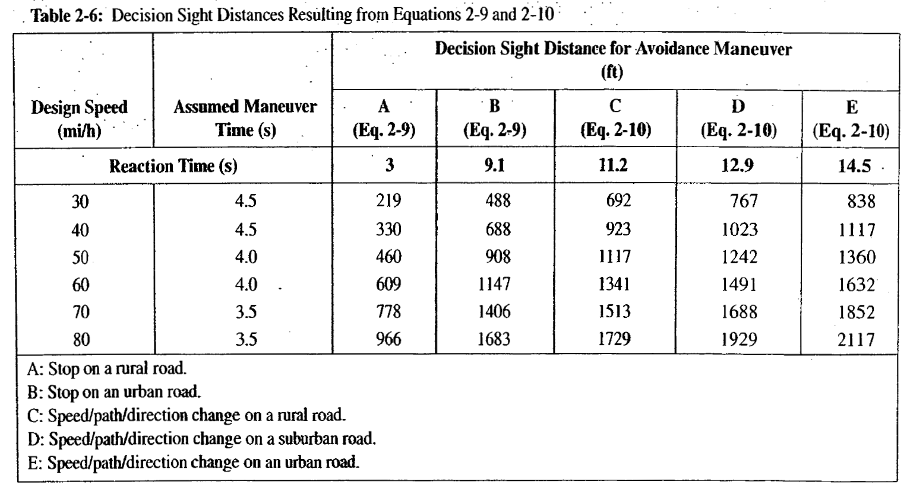
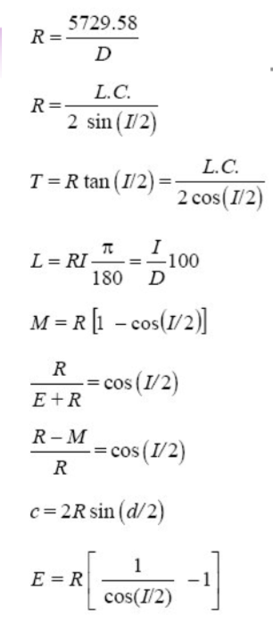
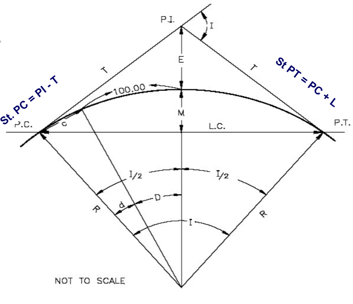
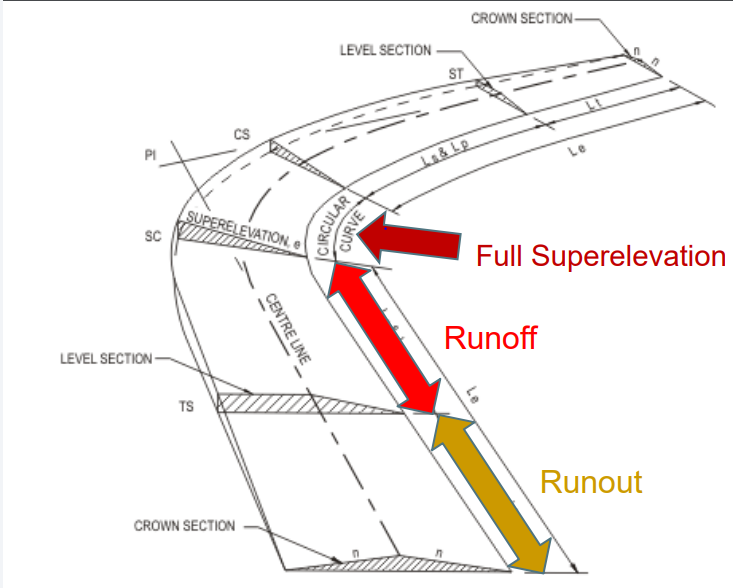
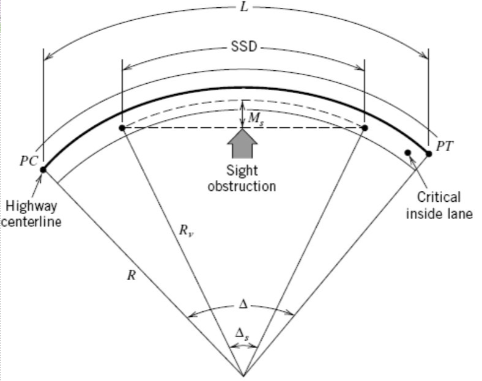
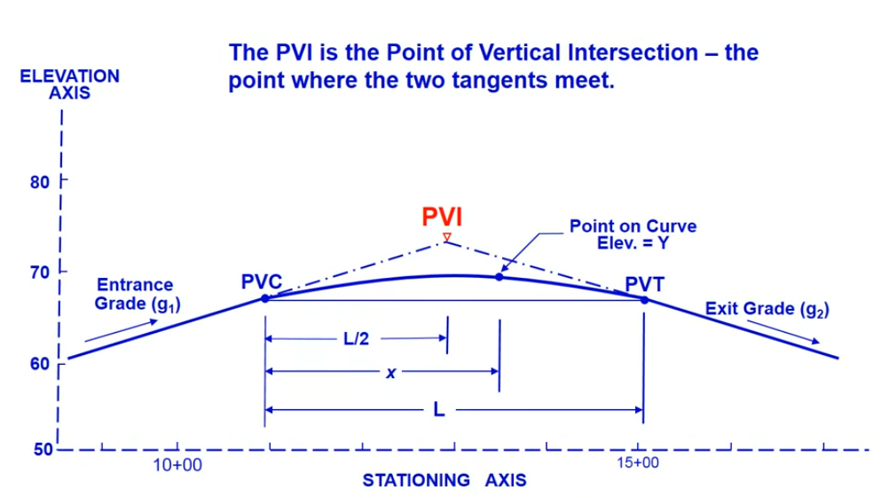
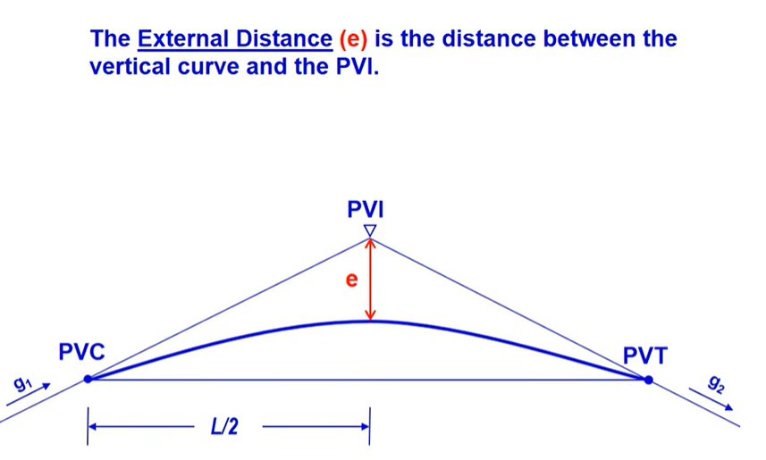

# Exam 1/MIDTERM: Related Formulas

## 1. Sight Distance (SD)</u>
### 1.1 Stopping SD (SSD)    

::::: {layout-ncol="2"}
::: {}
$$SSD\ =d_r +d_b$$
$$SSD\ = 1.47 \times S_i  \times t_r + \frac{S_i^2 - S_f^2}{30(F \pm G)}$$
:::

::: {}

Where:

* $d_r$: Reaction Distance
* $d_b$: Braking Distance
* $S_i$ or $S_f$: speed (initial or final)
* $G$: Grade (%) 
* $F=\frac{a}{g}$: Coefficient of friction, 
* $t_r=$ Reaction time 
  - AASHTO Design value: <mark>2.5 sec</mark>
  - ITE Signal Design value: <mark>1 sec (Expectancy)</mark>
* $a$: deceleration rate
:::
:::::
  
### 1.2 Decision SD (DSD)

## 2. Roadway Design</u>     
### 2.1 Horizontal Curve Design 
#### **Alignment and its equations**
:::: {.columns}

::: {.column width="30%"}

:::

::: {.column width="70%"}

:::

::::

#### **2.1.2 Superelevation** 

:::: {.columns}

::: {.column width="60%"}
$$L_r = \frac{w \times n \times e_d \times b_w}{\Delta}$$    

* $L_r$ = minimum length of superelevation runoff, ft
* $w$ = width of lane, ft
* $n$ = number of lanes being rotated (i.e. lanes in one direction)
* $e_d$ = design superelevation rate, expressed as a decimal
* $b_w$ = adjustment factor for number of lanes rotated 
* - 1: for one lane, 0.75 for two, 0.67 for three
* $\Delta$ = maximum relative gradient, (Table 27.3) expressed as a decimal

$$L_t = \frac{e_{NC}}{e_d} \times L_r$$    

* $L_t$ = length of tangent runoff, ft
* $L_r$ = length of superelevation runoff, ft
* $e_{NC}$ = normal cross-slope, % (for drainage)
* $e_d$ = design superelevation rate, %

:::

::: {.column width="40%"}

:::

::::

#### **2.1.3 Min. Radius of Curve**
$$R_{min} = \frac{V^2}{15(e+f)}$$
Where,

* $R_{min}$ = Minimum radius of the horizontal curve (measured in feet)
* $V$ = Design speed (measured in mph).
* $e$ = Rate of superelevation or road banking (expressed as a decimal, e.g., $(0.06) for \(6\%))$.
* $f$ = Side friction factor or coefficient of friction (expressed as a decimal based on your design speed).

#### **2.1.4 SSD on the curve**
:::: {.columns}

::: {.column width="60%"}
* $d_{ssd}=1.47S_i t + \frac{S_i^2 - S_f^2}{30(F \pm G)}$
* Design Stds:
  - $F=0.348$
* $M_{s}=R_v(1- cos \frac{90d_{ssd}}{\pi R_v})$
  - $R_v = \frac{5729.58}{D_v}$

:::

::: {.column width="40%"}

:::

::::

### 2.2 Vertical Curve Design
#### **2.2.1 Alignment and its equations**

:::: {.columns}

::: {.column width="60%"}

* $Y=ax^2+bx+c$
  - $Y$ = elev. of any point on the curve
  - $x$ = distance along stationing from PVC (VPC)
  - $a = \frac{g_2-g_1}{2L}$
  - $b = g_1$ = entrance grade
  - $c$ = elev. of PVC (VPC) = elev. of PVI (VPI) - $g_1 - \frac{L}{2}$
  - $L$ = length of curve
  
  
:::

::: {.column width="40%"}

:::

::::

:::: {.columns}

::: {.column width="60%"}

* $y$ (lowercase) = $ax^2$ = tangent offset 
  - $x=\frac{L}{2}$
  - $y=ax^2 = a (\frac{L}{2})^2$
  - $y=ax^2 = \frac{g_2-g_1}{2L}(\frac{L}{2})^2$
  - $y=ax^2 = \frac{AL}{8}$
* External Distance (e): between PVI and vertical curve
:::

::: {.column width="40%"}

:::

::::

**Ver. Curve: Special Points**

* $Y=ax^2+bx+c$
* For High/Low point on the curve $\frac{dY}{dx} = 0$
  - $\frac{d}{dx}(ax^2+bx+c) = 0$
  - $x_{high/low} = \frac{-g_1L}{g_2-g_1}$

#### 2.2.2 Min. length of Curve and 2.2.3 SSD on the curve

* available sight distance ≥ required stopping sight distance
* driver’s sight line just “grazes” the parabolic curve. 

**Min. Length ($L_{min}$)**

* <u>Driver and object both on the ver curve</u> ($d_{ssd} < L$)
  - $L_{min} = \frac{|g_2 - g_1| \times d_{ssd}^2}{2158}$   CREST curve
  - $L_{min} = \frac{|g_2 - g_1| \times d_{ssd}^2}{400+3.5d_{ssd}}$  SAG curve
* <u>sight distance extends beyond the curve onto a tangent</u> $d_{ssd} > L$
  - $L_{min} = 2d_{ssd} - \frac{2158}{|g_2 - g_1|}$  CREST curve
  - $L_{min} = 2d_{ssd} - (\frac{400+3.5d_{ssd}}{|g_2 - g_1|})$   SAG curve

* $G_1$ and $G_2$ are in $\%$

## 3. Traffic Stream Characteristics</u> 
### 3.1 Macroscopic Variables
* **Traffic Volume, $V$**
* **Traffic Flow, $q$**
  - $q = \frac{n}{t}$

  - **Daily Volumes/Flow** (vpd, Vehicles per day)

| Defn       | Space          | Count Period, *t*                       | Formula                            |
|------------|----------------|-----------------------------------------|------------------------------------|
| **AADT**:  | Given location | 365-day or 1 year                       | $\frac{n}{t=365}$                  |
| **AAWT**:  | Given location | weekdays over a full 365-year           | $\frac{n}{t=260}$                  |
| **ADT** :  | Given location | less than one year                      | $\frac{n}{t<365}$                  |
| **AWT** :  | Given location | weekdays and less than one year (month) | $\frac{n}{t\ weekdays\ and\ <365}$ |

  - **Hourly Volumes**
    - *Peak hour*: The single hour of the day that has the highest hourly volume is referred to as the peak hour.
    - *Peak-hour Traffic Volume*: Traffic Volume in the peak hour
    - *Directional Design Peak Hour (DDHV)*
      - $DDHV= AADT \times K \times D$
      - $K$ = proportion of daily traffic occurring during the peak hour
      - $D$ = proportion of peak hour trafic traveling in the peak direction of flow.

  - **Sub-Hourly Volumes** 
  Volumes observed for periods of less than one hour
    - *Hourly Volume*: Volume in one-hour
    - *Hourly Rates of Flow*: Volumes observed for periods of less than one hour and expressed as equivalent hourly volume
    - *Peak Hour Factor*
      - $PHF = \frac{V}{4*V_{m15}}$

### 3.2 Microscopic Variables

* <u>4. Traffic Flow Theory</u>
  - 4.1 Fundamental Identity Eq
  - 4.2 Traffic Stream Models
  - 4.3 Traffic Shockwave At Signalized Intersection
* <u>5. Traffic Control Devices</u>
  - 5.1 Intro to MUTCD Manual
  - 5.2 Traffic Signs, Markings, Traffic Signals
* <u>6. Statistical Applications in Transportation</u>
  - 6.1 Summarizing Data (Central Tendency, dispersion)
  - 6.2 Probability and Probability Distribution, 
  - 6.3 Hypothesis Testing
    - 6.3.1 Large sample inferences for two means
    - 6.3.2 Small sample inferences for two means
    - 6.3.3 Inferences for two variances

