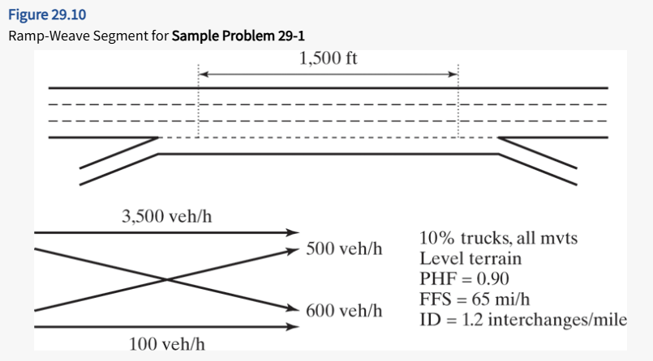
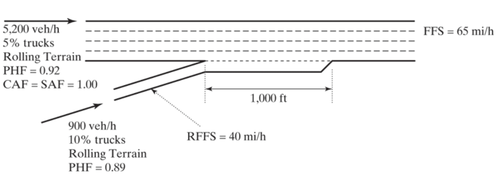

# Freeway Weaving Section

## Problem
Figure 29.10 illustrates a typical ramp-weave section on a six-lane freeway (three lanes in each direction). The analysis is to determine the expected level of service and capacity for the prevailing conditions shown.

## Solutions Steps: Freeway Weaving  {.smaller}

* STEP 1. Convert all demand volumes $(V)$ to Flow rates $(v)$
* STEP 2. Determine critical flows or variables for weaving analysis  
* STEP 3. Determine configuration characteristics  
* STEP 4. Determine max weaving length 
* STEP 5. Determine capacity of weaving segment
* STEP 6. Determine lane changing rates
* STEP 7. Determine the average speed of weaving and non-weaving vehicles
* STEP 8. Determine density and LOS

[Detailed Steps](notes_ch29_Freeway_weaving.qmd)

## STEP 1. $(V)$ to Flow rates $(v)$ {.smaller}

$$v_i = \frac{V}{PHF \times f_{HV} \times f_p}$$

* $f_{HV} = \frac{1}{1+P_{HV}(E_{HV}-1)}$
* $f_{HV} = \frac{1}{1+0.10(2-1)}$
* $f_{HV} = 0.909$

## STEP 1. $(V)$ to Flow rates $(v)$ {.smaller}

$$v_i = \frac{V}{PHF \times f_{HV} \times f_p}$$

* $v_{FF} = \frac{3500}{0.90 \times 0.909 \times 1} = 4,278$ pc/h
* $v_{RR} = \frac{100}{0.90 \times 0.909 \times 1} = 122$ pc/h
* $v_{FR} = \frac{600}{0.90 \times 0.909 \times 1} = 733$ pc/h
* $v_{RF} = \frac{500}{0.90 \times 0.909 \times 1} = 611$ pc/h

## STEP 2. Determine critical variables  {.smaller} 

* $v_W =  v_{RF} + v_{FR} = 733 + 611 = 1,344$ pc/h
* $v_{NW} = v_{FF} + v_{RR} = 4278 + 122 = 4,400$ pc/h
* $v = v_w + v_{nw} = 1,344 +  4,400 = 5,744$ pc/h
* $VR = \frac{v_w}{v} = \frac{1344}{5744} = 0.233$
* $R = \frac{v_{RF}}{v_W} = \frac{611}{1344} = 0.455$
* $L_S = 1500$ ft (given)

## STEP 3. Determine config charac  {.smaller} 

* $N_{WV}$ = number of lanes from which a weaving movement can be successfully executed with no more than one lane change
* $LC_{MIN} = (LC_{FR} \times v_{FR})+(LC_{RF} \times v_{RF})$
  - $LC_{FR}$ = minimum number of lane changes that must be made by freeway-to-ramp weaving vehicles to complete their maneuvers successfully
  - $LC_{FR}$ = minimum number of lane changes that must be made by ramp-to-freeway weaving vehicles to complete their maneuvers successfully

## STEP 3. Determine config charac  {.smaller} 

* $N_{WV} = 2$
* $LC_{MIN} = (LC_{FR} \times v_{FR})+(LC_{RF} \times v_{RF})$
* $LC_{MIN} = (1 \times 733)+(1 \times 611)$
* $LC_{MIN} = 1,344$ lc/h

## STEP 4. Determine max weaving length  {.smaller}

* $L_{MAX} = [5728(1+VR)^{1.6}]-[1566N_{WV}]$
* $L_{MAX} = [5728(1+0.233)^{1.6}]-[1566 \times 2]$
* $L_{MAX} = 4,876\ ft$ 

* Compare $L_{MAX}$ with $L_{S}$
  - $L_{MAX} > L_s(=1500\ ft)$
  - <mark>Analyze as Weaving section</mark>

## STEP 5. Determine capacity of weaving segment {.smaller}

* $c_W$ = Capacity of the weaving segment, (veh/h)
  - $c_W = min(c_{W1}, c_{W2})$
  - $c_{W1}$ = capacity (veh/h) of the weaving section based on breakdown density
  - $c_{W2}$ = capacity (veh/h) of the weaving section based on max weaving flow rates

## STEP 5. Determine capacity of weaving segment {.smaller}
#### Based on Breakdown density (LOS F): 43 pc/h/ln

:::: {.columns}

::: {.column width="45%"}
* $c_{W1} = c_{IWL} \times N \times f_{HV} \times f_p$
* $c_{W1} = 2092 \times 4 \times 0.909 \times 1.00$
* $c_{W1} = 7,607$ veh/h

:::

::: {.column width="55%"}
* $c_{IWL} = c_{IFL} - [438.2(1+VR)^{1.6}] + [0.0765L_S] + [119.8N_{WV}]$
* $c_{IWL} = 2,350 - [438.2(1+0.233)^{1.6}] + [0.0765 \times 1000] + [119.8 \times 2]$
* $c_{IWL} = 2,092$ pc/h/ln

:::

::::

## STEP 5. Determine capacity of weaving segment {.smaller}
#### Based on max weaving flow rates

* number of weaving vehicles reaches capacity before density of the weaving segment reaches 43 pc/h/ln
* $c_{W2} = c_{IW} \times f_{HV} \times f_p$
  - $c_{W2}$ = capacity (veh/h) of the weaving section based on max weaving flow rate
  - $c_{IW}$ = capacity (pc/h/lane) of weaving section under ideal conditions

|              | $c_{IW}$             |
|--------------|:--------------------:|
| $N_{WV} = 2$ | $\frac{2,400}{VR}$   |
| $N_{WV} = 3$ | $\frac{3,500}{VR}$   |

## STEP 5. Determine capacity of weaving segment {.smaller}
#### Based on max weaving flow rates

:::: {.columns}

::: {.column width="50%"}
* $c_{W2} = c_{IW} \times f_{HV} \times f_p$
* $c_{W2} = 10,300 \times 0.909 \times 1.00$
* $c_{W2} = 9,363$ veh/h

:::

::: {.column width="50%"}

* $N_{WV} = 2$
* $c_{IW} = \frac{2,400}{VR}$ 
* $c_{IW} = \frac{2,400}{0.233}$ 
* $c_{IW} = 10,300$ pc/h

|              | $c_{IW}$             |
|--------------|:--------------------:|
| $N_{WV} = 2$ | $\frac{2,400}{VR}$   |
| $N_{WV} = 3$ | $\frac{3,500}{VR}$   |
:::

::::

## STEP 5. Determine capacity of weaving segment {.smaller}

:::: {.columns}

::: {.column width="50%"}
* $c_W$ = Capacity of the weaving segment, (veh/h)
  - $c_W = min(c_{W1}, c_{W2})$
  - $c_W = (7607\ veh/h, 9363\ veh/h)$
  - $c_W = 7607\ veh/h$

* $v$ = total demand flow rate, (pc/h)
  - $v = v_{(pc/h)} \times f_{HV}$ (veh/h)
  - $v = 5744 \times 0.909$ (veh/h)
  - $v = 5,221$ (veh/h)

:::

::: {.column width="50%"}

<u>Calculate $v/c$ ratio</u>

* $v/c = 5221 / 7607$
* $v/c = 0.686 < 1$ 
* <mark>$v/c< 1 \to LOS \ne F$</mark> 

:::

::::

## STEP 6. Determine LC rates {.smaller}

* $LC_W$ needed to calculate speed and density in steps 7 and 8
* $LC_{ALL} = LC_W + LC_{NW}$
  - $LC_{ALL}$ = Total Lane-Changing Rate (LC)
  - $LC_W$ = Total Lane-Changing weaving vehicles
  - $LC_{NW}$ = Total Lane-Changing non-weaving vehicles

| Vehicles                  | Total Lane-Changing Rate (lc/h)                                             | 
|---------------------------|:---------------------------------------------------------------------------:|
| **Weaving**               | $LC_W = LC_{MIN}+0.39[(L_S-300)^{0.5}N^2(1+ID)^{0.8}]$                      | 
| **Non-Weaving: 1st est.** | $LC_{NW1} = (0.206 \times v_{NW}) + (0.542 \times L_S) - (192.6 \times N)$  |
| **Non-Weaving: 2nd est.** | $LC_{NW2} = 2135 + 0.223(v_{NW}-2000)$                                      |

## STEP 6. Determine LC rates {.smaller}
#### Weaving Vehicles

* $LC_W = LC_{MIN}+0.39[(L_S-300)^{0.5}N^2(1+ID)^{0.8}]$
* $LC_W = 1334+0.39[(1500-300)^{0.5}4^2(1+1.2)^{0.8}]$ ($LC{MIN}= 13444$ from step 3)
* $LC_W = 1,740$ lc/h

## STEP 6. Determine LC rates {.smaller}
#### non-Weaving Vehicles

* To determine which equation to use lane changing index, $I_{NW}$
  - $I_{NW}= \frac{L_S \times ID \times v_{NW}}{10,000}$
  - $I_{NW}= \frac{1500 \times 1.2 \times 4400}{10,000}$
  - $I_{NW}= 792$
* Since $I_{NW} \le 1,300$, use:
  - $LC_{NW} = LC_{NW1}$

| $I_{NW}$ values                 | $LC_{NW}$ Equation to use                                        |
|---------------------------------|------------------------------------------------------------------|
| $I_{NW} \le 1,300$              | $LC_{NW} = LC_{NW1}$                                             |
| $1,300I_{NW} < I_{NW} < 1,950$  | $LC_{NW}=LC_{NW1}+(LC_{NW2}-LC_{NW1})(\frac{I_{NW}-1300}{650})$  |
| $I_{NW} \ge 1,950$              | $LC_{NW} = LC_{NW2}$                                             |

## STEP 6. Determine LC rates {.smaller}
#### non-Weaving Vehicles

* Since $I_{NW} \le 1,300$, use:
  - $LC_{NW} = LC_{NW1}$ 
  - $LC_{NW} = (0.206 \times v_{NW}) + (0.542 \times L_S) - (192.6 \times N)$
  - $LC_{NW} = (0.206 \times 4400) + (0.542 \times 1500) - (192.6 \times 4)$  
  - $LC_{NW} = 949$ lc/h 

| Vehicles                  | Total Lane-Changing Rate (lc/h)                                             | 
|---------------------------|:---------------------------------------------------------------------------:|
| **Weaving**               | $LC_W = LC_{MIN}+0.39[(L_S-300)^{0.5}N^2(1+ID)^{0.8}]$                      | 
| **Non-Weaving: 1st est.** | $LC_{NW1} = (0.206 \times v_{NW}) + (0.542 \times L_S) - (192.6 \times N)$  |
| **Non-Weaving: 2nd est.** | $LC_{NW2} = 2135 + 0.223(v_{NW}-2000)$                                      |

## STEP 6. Determine LC rates {.smaller}

* $LC_W$ needed to calculate speed and density in steps 7 and 8
* $LC_{ALL} = LC_W + LC_{NW}$
  - $LC_{ALL} = 1740 + 949$
  - $LC_{ALL} = 2689$ lc/h

## STEP 7. Determine speeds {.smaller}
#### Average Speed of all Vehicles, $S$

* $S = \frac{v_{W} + v_{NW}}{\frac{v_{W}}{S_{W}} + \frac{v_{NW}}{S_{NW}}}$
  - $v_W$ = demand flow rate of <u>weaving</u> in the weaving section, pc/h
  - $v_{NW}$ = demand flow rate of <u>non-weaving</u> in the weaving section, pc/h
  - <mark>$S_W$ = average speed  of <u>weaving</u> in the weaving section, mph </mark>
  - <mark>$S_{NW}$ = average speed of <u>non-weaving</u> in the weaving section, mph </mark>

## STEP 7. Determine speeds {.smaller}
#### Average Speed of Weaving Vehicles, $S_W$

:::: {.columns}

::: {.column width="50%"}

* $S_W = S_{MIN} + (\frac{S_{MAX}- S_{MIN}}{1+W})$
* $S_W = 15 + (\frac{FFS - 15}{1+W})$
  - $S_{MIN} = 15 mph$ = min. average speed of <u>weaving</u> vehicles expected in the weaving section, mph
  - $S_{MAX} = FFS$ = max. average speed of <u>weaving</u> vehicles expected in the weaving section, mph
* $S_W = 15 + (\frac{65 - 15}{1+0.3582})$  
* $S_W = 51.8$ mph  

:::

::: {.column width="50%"}

* $W$ = weaving intesity factor
    - $W = 0.226(\frac{LC_{ALL}}{L_S})^{0.789}$
    - $W = 0.226(\frac{2689}{1500})^{0.789}$
    - $W = 0.3582$

:::

::::   

## STEP 7. Determine speeds {.smaller}
#### Average Speed of Non-Weaving Vehicles, $S_{NW}$

* $S_{NW} = FFS \times SAF  - (0.0072LC_{MIN}) - (0.0048\frac{v}{N})$
* $S_{NW} = 65 \times 1 - (0.0072 \times 1344) - (0.0048\frac{5744}{4})$
* $S_{NW} = 48.4$ mph

## STEP 7. Determine speeds {.smaller}
#### Average Speed of all Vehicles, $S$

* $S = \frac{v_{W} + v_{NW}}{\frac{v_{W}}{S_{W}} + \frac{v_{NW}}{S_{NW}}}$
* $S = \frac{1344 + 4400}{\frac{1344}{51.8} + \frac{4400}{48.4}}$
* $S = 49.1$ mph

    
## STEP 8. Determine density and LOS {.smaller}

* $D = \frac{(v/N)}{S}$
* $D = \frac{(5744/4)}{49.1}$
* $D = 29.2$ pc/mi/ln
  - <mark>LOS D; very close to LOS C/D</mark>

# Freeway Merging/Diverging Section

## Problem
An on-ramp to a busy eight-lane urban freeway is illustrated in following Figure. An analysis of this merge area is to determine the likely level of service under the prevailing conditions shown.

## Solutions Steps  {.smaller}

* STEP 1. Convert all demand volumes $(V)$ to Flow rates $(v)$  
* STEP 2. Determine demand flows in lane 1 and lane 2 immediately upstream of merge/diverge   
* STEP 3. Determine whether the demand flow exceeds the capacity   
* STEP 4. Determine the density of all vehicles within the ramp influence area 
* STEP 5. Determine the speed of all vehicles within the ramp influence area and across all facility lanes

[Detailed Steps](notes_ch30_Freeway_merging.qmd)

## STEP 1. $(V)$ to Flow rates $(v)$ {.smaller}

:::: {.columns}

::: {.column width="50%"}
#### Freeway
* $f_{HV} = \frac{1}{1+P_{HV}(E_{HV}-1)}$
* $f_{HV} = \frac{1}{1+0.05(2.5-1)}$
* $f_{HV} = 0.93$

* $v_F = \frac{V}{PHF \times f_{HV} \times f_p}$
* $v_F = \frac{5200}{0.92 \times 0.93 \times 1.00}$
* $v_F = 6,078$ pc/h
:::

::: {.column width="50%"}
#### Ramp
* $f_{HV} = \frac{1}{1+P_{HV}(E_{HV}-1)}$
* $f_{HV} = \frac{1}{1+0.10(2.5-1)}$
* $f_{HV} = 0.870$

* $v_R = \frac{V}{PHF \times f_{HV} \times f_p}$
* $v_R = \frac{900}{0.89\times 0.87 \times 1.00}$
* $v_R = 1,162$ pc/h

:::

::::

## STEP 1. $(V)$ to Flow rates $(v)$ {.smaller}

* $v_F = 6,078$ pc/h
* $v_R = 1,162$ pc/h

## STEP 2. Determine $v_{12}$ {.smaller}

$$v_{12}= v_F \times P_{FM}$$

* Find Eq. for $P_{FM}$
  - Given, total 8 lanes (4 lanes/dir)
  - $\frac{v_F}{RFFS} = \frac{6,078}{40}$
  - $\frac{v_F}{RFFS} = 151.9 > 72$

* $P_{FM} = 0.2178-0.000125v_R$
* $P_{FM} = 0.2178-0.000125(1162)$
* $P_{FM} = 0.0726$

## STEP 2. Determine $v_{12}$ {.smaller}

$$v_{12}= v_F \times P_{FM}$$
$$v_{12}= 6078 \times 0.0726$$
$$v_{12}= 441\ pc/h$$
$$avg.\ v_{12}= 221\ pc/h/ln$$

## STEP 2. Determine $v_{12}$ {.smaller}

#### Reasonableness Criteria Check

* <u>Criteria 1</u>: Average flow rate in the outer lanes ($avg.\ v_{oa}$) may not exceed 2,700 pc/h/ln.
  - $v_{oa} = v_F - v_{12}$
  - $v_{oa} = 6078 - 441$
  - $v_{oa} = 5,637$ pc/h
  - $avg.\ v_{oa} = 5,637 /2 = 2,819 > 2700$ <mark>Violation</mark> 
  
* <u>Criteria 2</u>: Average flow rate in the outer lanes ($avg.\ v_{oa}$) may not be more than 1.5 times the average flow rate in lanes 1 and 2 ($avg.\ v_{12}$).
  - $1.5 \times avg.\ v_{12} = 1.5 \times 221 = 332$ pc/h/ln
  - $avg.\ v_{oa} = 2,819 > 332$ <mark>Violation</mark>
  
## STEP 2. Determine $v_{12}$ {.smaller}

#### Adjustment

* Adjustment for <u>Criteria 2</u>
    - For $N_o =2: v_{12} = \frac{V_F}{2.50}$
    - $v_{12} = \frac{6078}{2.50}$
    - $v_{12} = 2,431$ pc/h; $avg. v_{12} = 1,216$ pc/h/ln 
    - $v_{oa} = 6078 - 2,431$ pc/h
    - $v_{oa} = 3,647$ pc/h
    - $avg.\ v_{oa} = 1,824$ pc/h/ln
    
* Check <u>Criteria 1 & 2</u>
    - <u>Criteria 1</u>: $avg.\ v_{oa} = 1,824 < 2,700$ pc/h/ln
    - <u>Criteria 1</u>: $avg.\ v_{oa} = 1,824 \le (1.5 \times 1216=1824)$ pc/h/ln
* <mark>Satisfies <u>Criteria 1 & 2</u></mark>

## STEP 2. Determine $v_{12}$ {.smaller}

* $v_F = 6,078$ pc/h
* $v_R = 1,162$ pc/h
* $v_{12} = 2,431$ pc/h
* $v_{oa} = 3,647$ pc/h

## STEP 3. Determine if LOS F  {.smaller}

* <u>Check 1: $v_{FO} < Cap_{DN}$</u>
  - $v_{FO} = v_F + v_R = 6078+1162 = 7,240$ pc/h
  - From Table, $Cap_{DN} = 9,400$ pc/h
  - Since $Cap_{DN} > v_{FO}$; Capacity is higher <mark>NO FAILURE EXPECTED</mark>

## STEP 3. Determine if LOS F {.smaller}

* <u>Check 2: $v_{12R} < Cap_{maxDesireable}$</u>
  - $v{12R}=v{12}+v{R} = 2,431 + 1,162 = 3,593$ pc/h
  - From Table, $Cap_{maxDesireable} = 4,600$ pc/h
  - Since $Cap_{maxDesireable} > v_{12R}$; Capacity is higher <mark>NO FAILURE EXPECTED</mark>

## STEP 3. Determine if LOS F {.smaller}

* <u>Check 3: $v_{R} < Cap_{R}$</u>
  - $v{R} = 1,162$ pc/h
  - From Table, $Cap_{R} = 2,000$ pc/h (RFFS = 40 mph, single lane)
  - Since $Cap_{R} > v_{R}$; Capacity is higher <mark>NO FAILURE EXPECTED</mark>

## STEP 4. Determine the density $D_R$  {.smaller}

* $D_R = 5.475 + 0.00734v_R+0.0078v_{12}-0.00627L_a$
* $D_R = 5.475 + 0.00734 \times 1162 + 0.0078 \times 2431 - 0.00627 \times 1000$
* $D_R = 26.7\ pc/mi/ln \to$ <mark>**LOS C**</mark>

## STEP 5. Determine the speed   {.smaller}

## STEP 5. Determine the speed   {.smaller}

* $M_S = 0.383$  
* $S_R = 56.2$ mph
* $S_o = 60.2$ mph
* $S = 57.2$ mph
