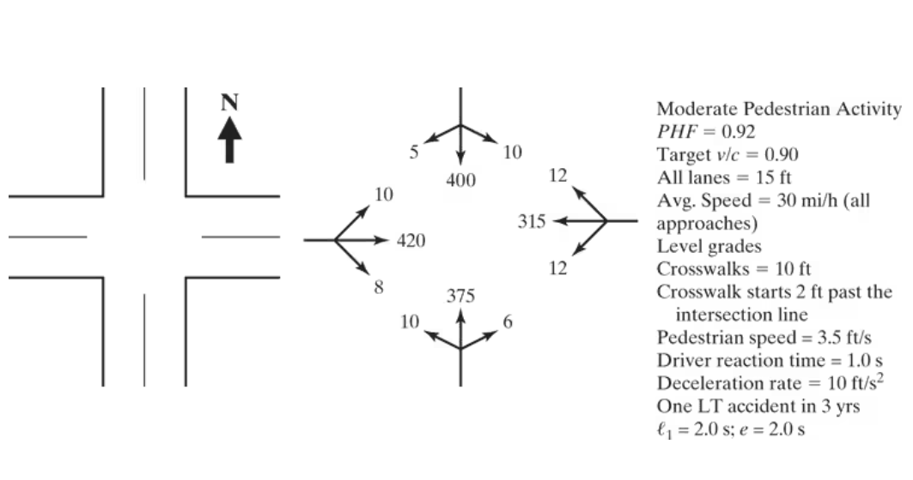
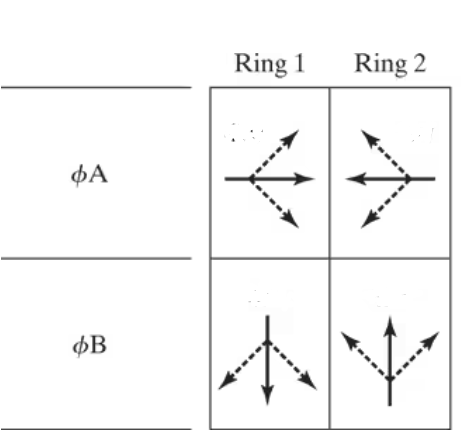
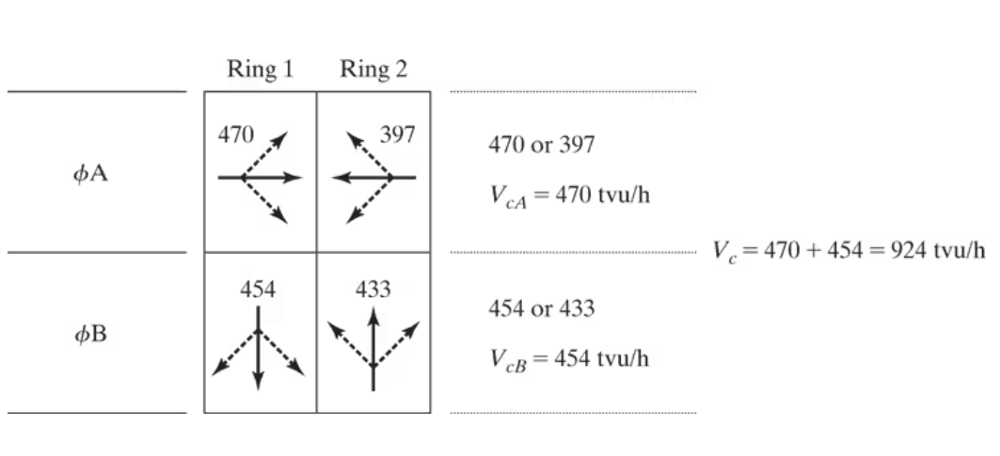
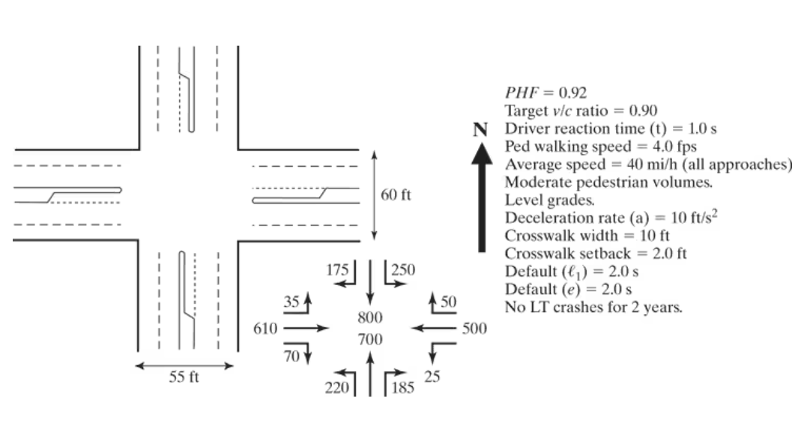
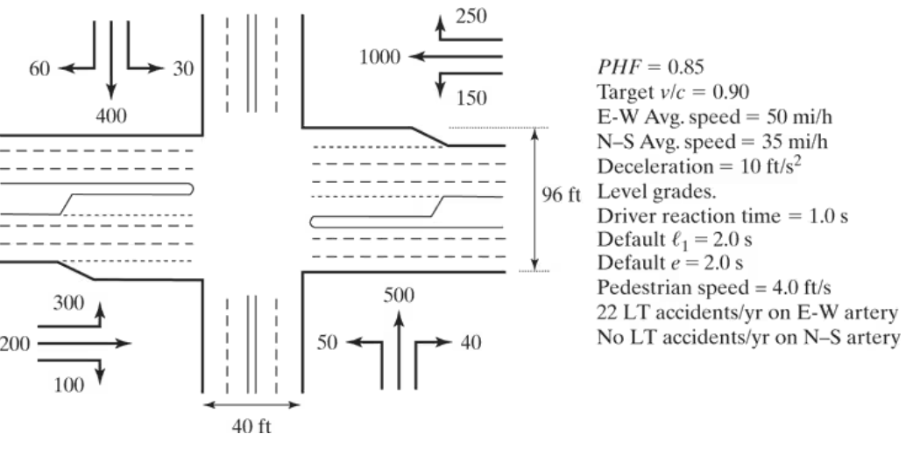
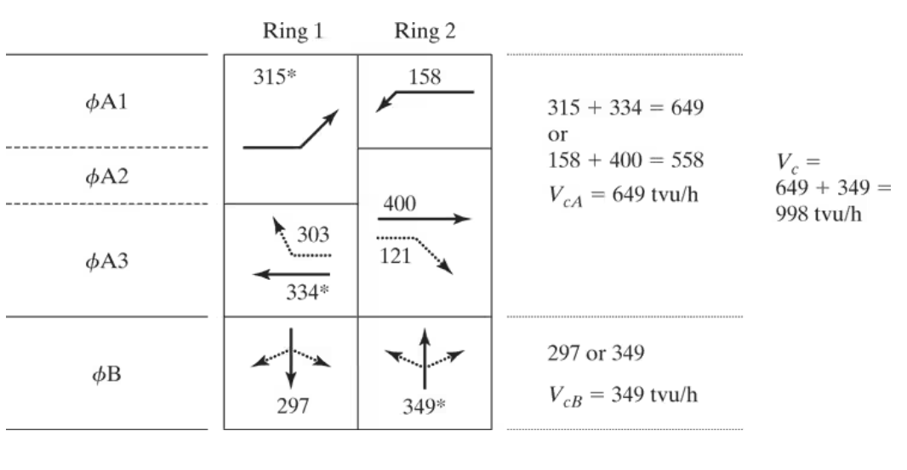
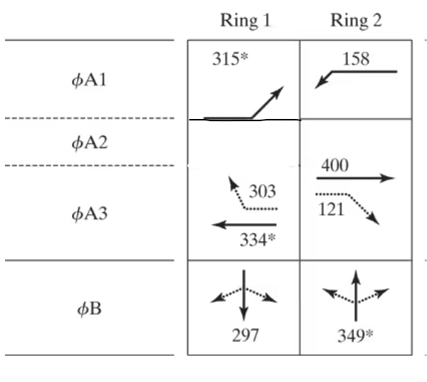
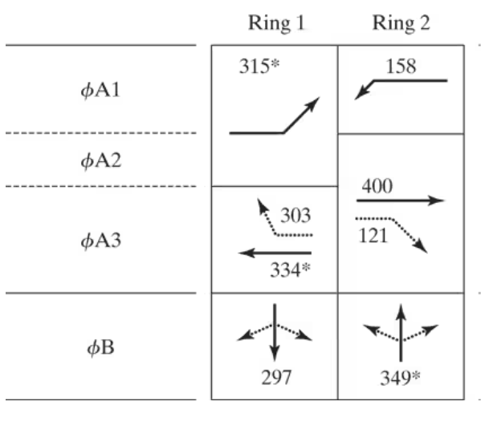

## Fundamentals of Signal Timing and Design: Pre-timed Signals

* [Signal Timing and Pre-timed Signals  Design](images/Lecture17_preTime.pdf)
* [Saturation Flow Calculation](images/Chapter24_Saturation_Flow_Rate.pdf)

## Example Problem: 19-7

## STEP 1  {.smaller}
### STEP 1A: Left turn treatment

| Approach | Movement | volume (veh/h) | <200 veh/h? | Met?    |
|----------|----------|:--------------:|:-----------:|---------|
| EB       | LT       | 10             | yes         | NOT MET |
| WB       | LT       | 12             | yes         | NOT MET |
| NB       | LT       | 10             | yes         | NOT MET |
| SB       | LT       | 10             | yes         | NOT MET |

## STEP 1  {.smaller}
### STEP 1A: Left turn treatment

| Approach | Movement | volume (veh/h) | Opposing Vol | Opposing lane | Opposing vol/lane | <50,000? | Met?    |
|----------|----------|:--------------:|--------------|---------------|-------------------|:--------:|---------|
| EB       | LT       | 10             | 315          | 1             | 315               | yes      | NOT MET |
| WB       | LT       | 12             | 420          | 1             | 420               | yes      | NOT MET |
| NB       | LT       | 10             | 400          | 1             | 400               | yes      | NOT MET |
| SB       | LT       | 10             | 375          | 1             | 375               | yes      | NOT MET |

## STEP 1: Phase Plan  {.smaller}

## STEP 1: Phase Plan/ Ring Diagram  {.smaller}

## STEP 2:Conversion of Volumes to tvu {.smaller}

| Approach | Mvmt | V (veh/h) | Equiv. | V (tvu/h) | V-LG | N - LG | V/N - LG | s | v/s |
|----------|------|:---------:|--------|-----------|------|:------:|----------|---|-----|
| EB       | L    | 10        | 3.90   | 39        |      |        |          |   |     |
|          | T    | 420       | 1      | 420       | 470  | 1      | 470      | - | -   |
|          | R    | 8         | 1.32   | 11        |      |        |          |   |     |
| WB       | L    | 12        | 5.50   | 66        |      |        |          |   |     |
|          | T    | 315       | 1      | 315       | 397  | 1      | 397      | - | -   |
|          | R    | 12        | 1.32   | 16        |      |        |          |   |     |
| NB       | L    | 10        | 5      | 50        |      |        |          |   |     |
|          | T    | 375       | 1      | 375       | 433  | 1      | 433      | - | -   |
|          | R    | 6         | 4.70   | 8         |      |        |          |   |     |
| SB       | L    | 10        | 1.32   | 47        |      |        |          |   |     |
|          | T    | 400       | 1      | 400       | 454  | 1      | 454      | - | -   |
|          | R    | 5         | 1.32   | 7         |      |        |          |   |     |

## STEP 2:Conversion of Volumes to tvu {.smaller}

## STEP 3: Determine Critical-Lane Volumes  {.smaller}

## STEP 3: Determine Critical-Lane Volumes 

## STEP 4: Determine Yellow and All-Red Intervals Yellow and all-red 

* $y_{phase} = t + \frac{1.47 \times S_{85}}{2 \times (a + 32.2 G)}$

* $y_A = 1 + \frac{1.47 \times 35}{2 \times (10 + 32.2 \times 0)}$
* $y_A = 3.6$ sec

* $y_B = 1 + \frac{1.47 \times 35}{2 \times (10 + 32.2 \times 0)}$
* $y_B = 3.6$ sec

## STEP 4: Determine Yellow and All-Red Intervals Yellow and all-red 

* $ar_{phase} = \frac{P+L}{1.47 \times S_{15}}$

* $ar_{A} = \frac{42+20}{1.47 \times 25}$
* $ar_{A} = 1.7$ sec

* $ar_{B} = \frac{42+20}{1.47 \times 25}$
* $ar_{B} = 1.7$ sec

## STEP 4: Determine Yellow and All-Red Intervals Yellow and all-red 

## STEP 5: Determination of Lost Times {.smaller}

::: {.columns}

::: {.column width="50%"}
### Phase A
* $l_{1A} = 2$ sec
* $e = 2$  sec
* $l_2 = y_{phase} + ar_{phase} - e$
* $l_{2A} = 3.6 + 1.7 - 2 = 3.3$ sec
* $t_{LA} = l_{2A} + l_{2B} = 2+3.3 = 5.3$ sec

:::

::: {.column width="50%"}
### Phase B
* $l_{1B} = 2$ sec
* $e = 2$ sec
* $l_2 = y_{phase} + ar_{phase} - e$
* $l_{2B} = 3.6 + 1.7 - 2 = 3.3$ sec
* $t_{LB} = l_{2A} + l_{2B} = 2+3.3 = 5.3$ sec

:::

:::

## STEP 5: Determination of Lost Times

* Total lost time per cycle
* $L = t_{LA} + t_{LB}$
* $L = 5.3 + 5.3$
* $L = 10.6$

## STEP 5: Determination of Lost Times

## STEP 6: Determine the Desirable Cycle Length

* $C_{des} = \frac{L}{1- [\frac{V_c}{1700 \times PHF \times (v/c)}]}$
* $C_{des} = \frac{10.6}{1- [\frac{924}{1700 \times 0.92 \times (0.90)}]}$
* $C_{des} = 30.8$
* $C_{des} = 35$ sec [upper to 35 or 40 sec] 

## STEP 6: Determine the Desirable Cycle Length

## STEP 7:Allocate Effective Green to Each Phase {.smaller}

Effective green time/phase, $$g_{phase} = (C_{des} - L) (\frac{V_{c-phase}}{V_c})$$

::: {.columns}
::: {.column width="50%"}
### Phase A
* $g_{phase} = (C_{des} - L) (\frac{V_{c-phase}}{V_c})$
* $g_{A} = (35 - 10.6) (\frac{470}{924})$
* $g_{A} = 12.4$ sec

:::
::: {.column width="50%"}
### Phase B
* $g_{phase} = (C_{des} - L) (\frac{V_{c-phase}}{V_c})$
* $g_{B} = (35 - 10.6) (\frac{454}{924})$
* $g_{B} = 12.0$ sec
:::
:::

## STEP 7:Allocate Effective Green to Each Phase {.smaller}

Actual green time/phase, $$G_{phase} = g_{phase} + l_{1-phase}-e$$

::: {.columns}
::: {.column width="50%"}
### Phase A
* $G_{A} = g_{A} + l_{1-A}-e$
* $G_{A} = 12.4+2-2$
* $G_{A} = 12.4$ sec

:::
::: {.column width="50%"}
### Phase B
* $G_{B} = g_{B} + l_{1-A}-e$
* $G_{B} = 12.0+2-2$
* $G_{B} = 12.0$ sec
:::
:::

## STEP 7:Allocate Effective Green to Each Phase

## STEP 8: Check Pedestrian Requirements {.smaller}

minimum pedestrian green requirement, $G_{p} = PW_{min} + PC$

::: {.columns}

::: {.column width="50%"}

* $PW_{min}$ = Table 19.6 for "typical" ped
* $PW_{min} = 7$ sec

:::

::: {.column width="50%"}

* $PC = \frac{L}{S_p}$
* $PC = \frac{30}{3.5}$
* $PC = 8.6$ sec

:::

:::

each phase must accommodate a minimum pedestrian time of 7+ 8.6 = 15.6 sec

## STEP 8: Check Pedestrian Requirements {.smaller}

| phase | $G$    |  $y$  | $ar$  | $G_p^1$   | $G_p^2$   |  $G_p^3$  |
|-------|--------|:-----:|-------|-----------|-----------|:---------:|
| A     | 12.4   | 3.6   | 1.7   | 17.7      | 16.0      | 12.4      |
| B     | 12.0   | 3.6   | 1.7   | 17.3      | 15.6      | 12.0      |

* $G_p = PW_{phase} + PC$

* Option 1: $G_p^1 = PW_{phase} + PC \le G_{phase} + y_{phase} + ar_{phase}$
* Option 2: $G_p^2 \le G_{phase} + y_{phase}$
* Option 3: $G_p^3 \le G_{phase}$

## STEP 8: Check Pedestrian Requirements {.smaller}

## STEP 9: Adjustment {.smaller}

* For option 3
* green times of both Phases A and B need to be increased to a minimum of 15.6 seconds.
* Phase B, which has the shorter green (12.0 sec), would control how much more time is needed.
* Ratio $= \frac{15.6}{12.0}= 1.3$
* Increase cycle lenght = $35 \times 1.3 = 45.5$sec
* Cycle lenght, $C_{adj} = 50$ sec

## STEP 9: Adjustment {.smaller}

Effective green time/phase, $$g_{phase} = (C_{des} - L) (\frac{V_{c-phase}}{V_c})$$

::: {.columns}
::: {.column width="50%"}
### Phase A
* $g_{phase} = (C_{adj} - L) (\frac{V_{c-phase}}{V_c})$
* $g_{A} = (50 - 10.6) (\frac{470}{924})$
* $g_{A} = 20$ sec

:::
::: {.column width="50%"}
### Phase B
* $g_{phase} = (C_{adj} - L) (\frac{V_{c-phase}}{V_c})$
* $g_{B} = (35 - 10.6) (\frac{454}{924})$
* $g_{B} = 19.4$ sec
:::
:::

## STEP 9: Adjustment {.smaller}

minimum pedestrian green requirement, $G_{p} = PW_{min} + PC$

::: {.columns}

::: {.column width="50%"}
### Phase A

* $PW_{A} = g_A - PC$ sec
* $PW_{A} = 20.0 - 8.6$ sec
* $PW_{A} = 13.4$ sec

:::

::: {.column width="50%"}
### Phase B
* $PW_{B} = g_B - PC$ sec
* $PW_{B} = 19.4 - 8.6$ sec
* $PW_{B} = 12.8$ sec

:::

:::

## Example Problem: 19-7

## Example Problem: 19-9

## Example Problem: 19-9

### OVERLAPPING

## Example Problem: 19-9 | PHASE

::: {.columns}

::: {.column width="50%"}
### NON-OVERLAPPING

:::

::: {.column width="50%"}
### OVERLAPPING

:::

:::
