## Fundamentals of Signal Timing and Design: Actuated Signals

* [Signal Timing and Pre-timed Signals  Design](images/chap20/Chapter22_Actuated_Signal_Design_15FEB.pdf)

## Actuated Signals: Cycle

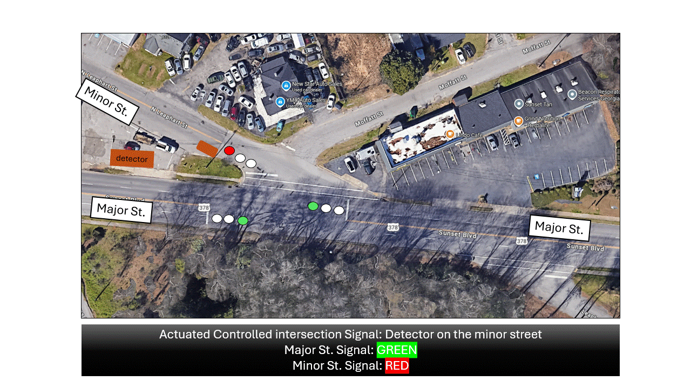

## Actuated Signals: Sample Problem

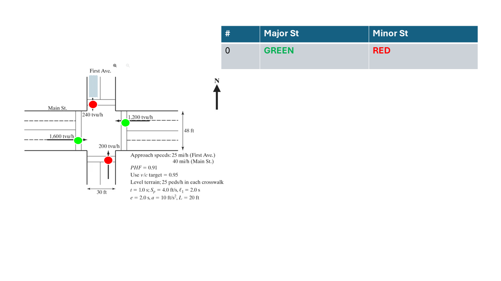

## Actuated Signals: Sample Problem

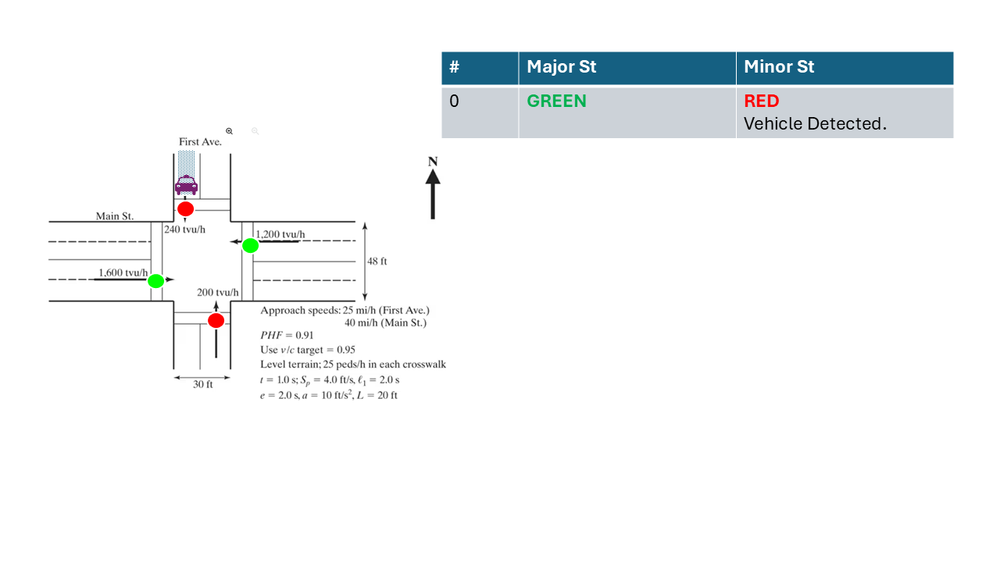

## Actuated Signals: Sample Problem

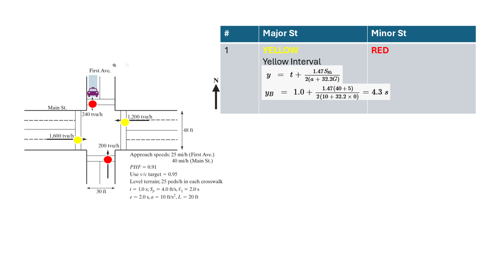

## Actuated Signals: Sample Problem

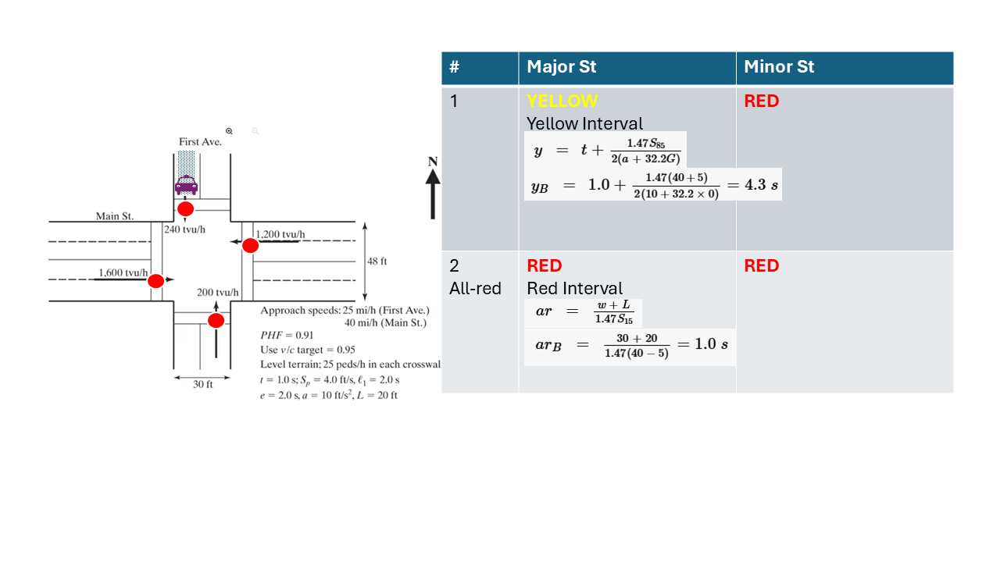

## Actuated Signals: Sample Problem

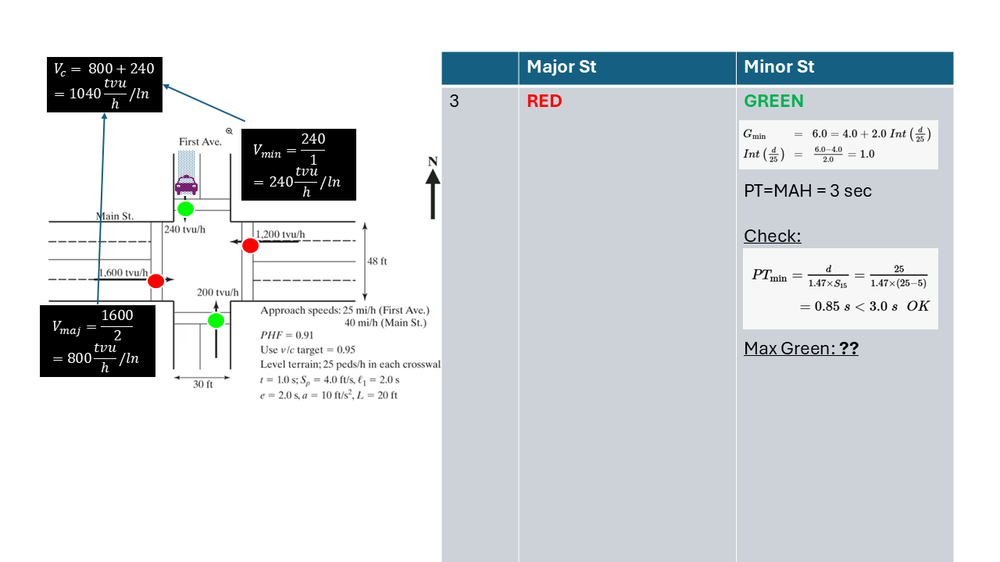

## Actuated Signals: Sample Problem

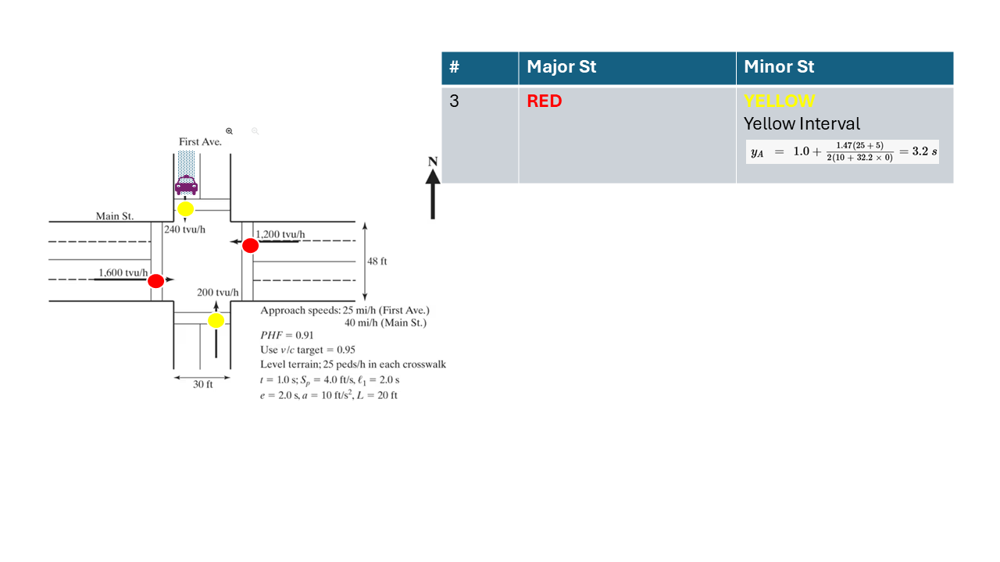

## Actuated Signals: Sample Problem

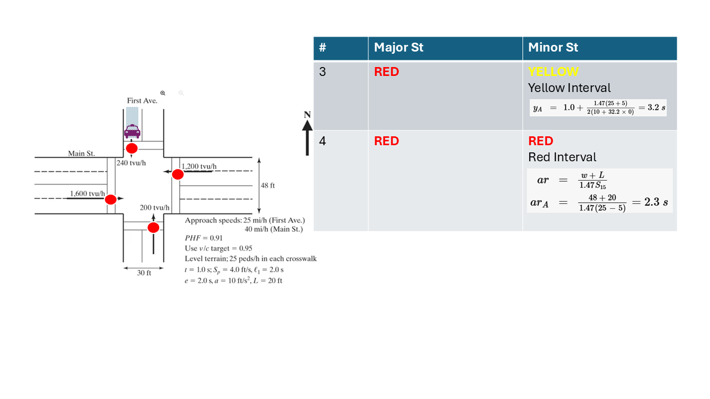

## Actuated Signals: Sample Problem

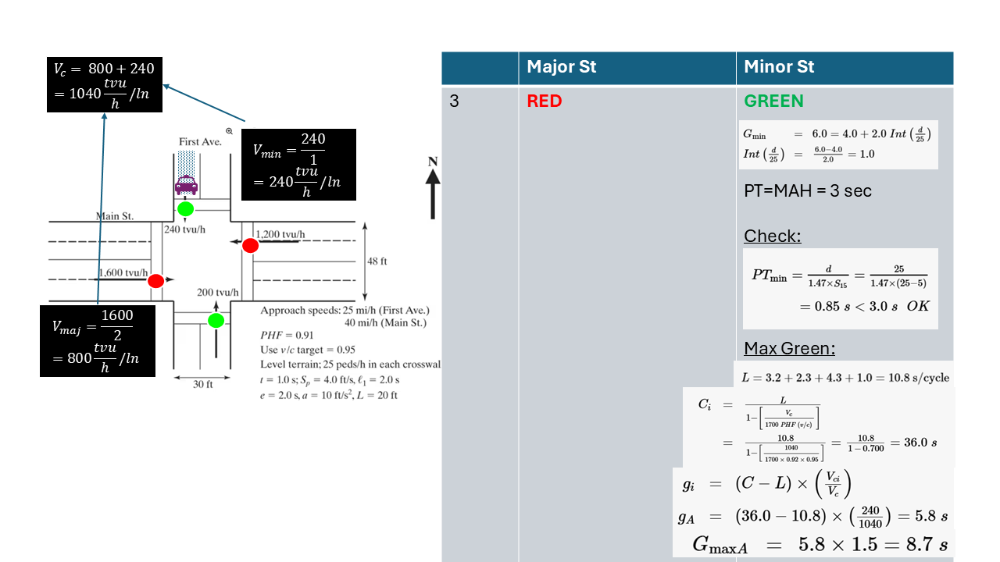

## Actuated Signals: Sample Problem

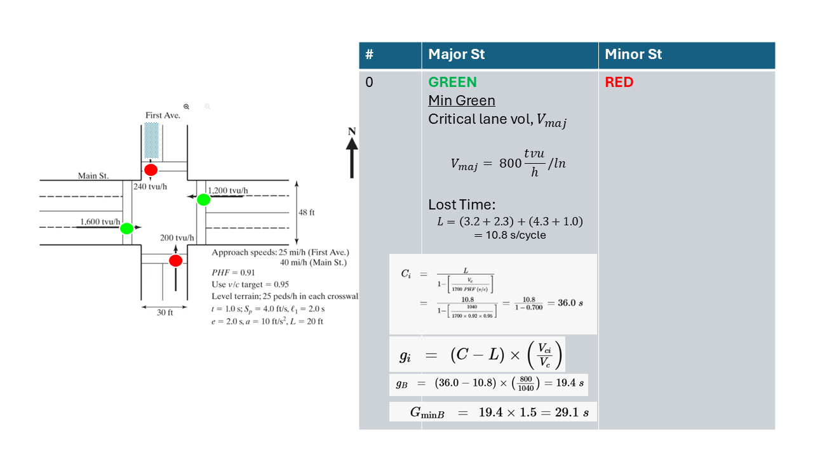

## Actuated Signals: Sample Problem

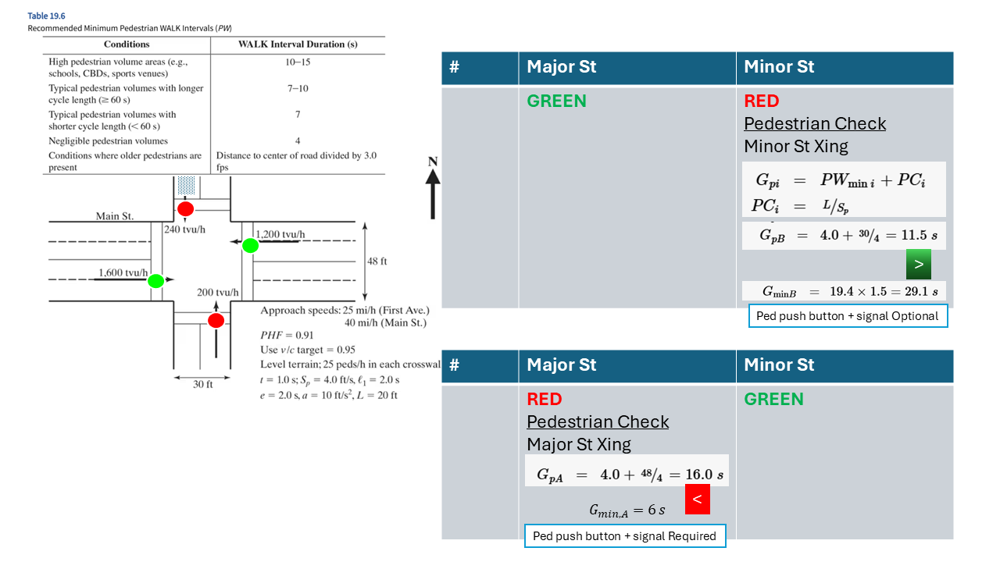