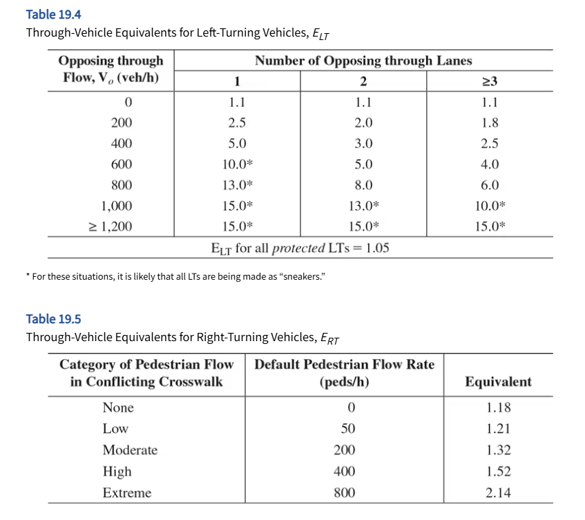

# STEPS

* [STEP 1. Check for LT treatment and Develop a Phase Plan](#step1)    
* [STEP 2. Convert Volumes to Through Vehicle Equivalents](#step2)    
* [STEP 3. Determine Lane Groups and Critical Lane Volumes](#step3)   
* [STEP 4. Determine Yellow and All-Red Intervals](#step4) 
* [STEP 5. Determine the Lost time](#step5)
* [STEP 6. Determine the Desireable Cycle Length](#step6)
* [STEP 7. Allocate Effective Green to Each Phase](#step7)
* [STEP 8. Check Pedestrian Requirements](#step8)

## Terminologies

## STEP 1. Check for LT treatment and Develop a Phase Plan {#step1}
### 1A - Left-turn Signal: Protected or  Permitted?
If <u>either of the two criteria</u> below are exceeded, it is common practice to implement some form of left-turn protection:

* Criteria 1: $\nu_{LT} \ge 200$ veh/h
* Criteria 2 (Cross-product rule): $xprod =  \nu_{LT} \times \frac{\nu_0}{N_0} \ge 50,000$

where,

* $\nu_{LT}$ = left-turn flow rate, veh/h
* $\nu_0$ = opposing through movement flow rate, veh/h
* $N_0$ = number of opposing through lanes

### 1B - Develop Phasing Diagram

#### Phase Diagram
A phase diagram shows all movements being made in a given phase within a single block of the diagram. 

#### Ring Diagram
A ring diagram shows which movements are controlled by which “ring” on a signal controller. A “ring” of a controller generally controls one set of signal faces.

#### Definition of Phasing Symbols

1. A solid arrow denotes a movement without opposition. All through movements are unopposed by definition. An unopposed left turn has no opposing through vehicular flow. An unopposed right turn has no opposing pedestrian movement in the crosswalk through which the right turn is made.
2. Opposed left- and or right-turn movements are shown as a dashed line.
3. Turning movements made from a shared lane(s) are shown as arrows connected to the through movement that shares the lane(s).
4. Turning movements from an exclusive lane(s) are shown as separate arrows, not connected to any through movement.

## STEP 2. Convert Volumes to Through Vehicle Equivalents {#step2}

* Equivalent LT volume in through-vehicle equivalents, $V_{LTE} = V_{LT} \times E_{LT}$ tvu/h
* Equivalent RT volume in through-vehicle equivalents, $V_{RTE} = V_{RT} \times E_{RT}$ tvu/h
* Total equivalent volume for a given approach or lane group, $V_{EQ} = V_{LTE} + V_{TH} + V_{RTE}$ tvu/h
  - Per lane: $V_{EQL} = V_{EQ} / N$ tvu/h
  

<u>NOTE:</u> Interpolation allowed

## STEP 3. Determine Lane Groups and Critical Lane Volumes {#step3}

critical-lane volume is the per-lane volume that controls the required length of a particular phase.
To find the critical path, the controlling (maximum) equivalent volumes must be found for each portion of the cycle, working between full-phase transition boundaries. 
## STEP 4. Determine Yellow and All-Red Intervals {#step4}

### Yellow Interval
The ITE recommends the following methodology for determining the length of the yellow or change interval 

$$y_i = t + \frac{1.47 \times S_{85i}}{2 \times (a + 32.2 G_i)}$$
where:

* $y_i$ = length of the yellow for phase $i$, sec
* $t$ = driver reaction time, sec (Default is <mark>1 sec</mark>)
* $S_{85i}$ = 85th percentile speed of approaching vehicle in phase $i$ or Speed Limit (mph)
  - $S_{85i} = S_{avg} + 5$
* $a$ = Deceleration rate of vehicles, $ft/s^2$
* $G_i$ = Approach grade for phase $i$ in decimal

### All-red Interval
The ITE also recommends the following policy for determining the length of all-red clearance intervals 

| Pedestrian Traffic  | All-Red Interval Eqn            |
|---------------------|---------------------------------|
| **No or Little Ped**|$ar_i = \frac{w+L}{1.47S_{15i}}$ |
| **Somewhat Ped**    |                                |
| **Significant Ped  **|$ar_i = \frac{P+L}{1.47S_{15i}}$ |

Where:

* $ar_i$ = length of the all-red phase for phase $i$, sec
* $w$ = width of the street being crossed, from curb to curb, ft
* $P$ = distance from the near curb to the far side of the crosswalk on the departure leg, ft
* $L$ = length of the standard vehicle (18-20 feet)
* $S_{15i}$ = 15th percentile speed of approaching traffic in phase $i$, mph
  - $S_{15i} = S_{avg} - 5$

<u>NOTE:</u>
Use of these ITE policies to determine yellow and all-red intervals assures that drivers will not be presented with a “dilemma zone,” which occurs when the combined length of the change and clearance intervals is not sufficient to allow a motorist who cannot safely stop when the yellow is initiated to cross through the intersection and out of conflicting vehicular and/or pedestrian paths before those flows are released.
  
## STEP 5. Determine the Lost time {#step5}

HCM recommends the following:

* Start-up lost time, $l_{1i} = 2$ sec/phase
* Motorist use of yellow and all-red, $e= 2$ sec/phase
* Clearance lost time, $l_{2i} = y_i + ar_i - e$ sec/phase
* Total lost time, $t_{Li} = l_{1i} + l_{2i} = 2 + y_i + ar_i - e$ sec/phase

## STEP 6. Determine the Desireable Cycle Length {#step6}

$$C_{des} = \frac{L}{1 - \frac{V_c}{1700 \times PHF \times (\nu/c)}}$$
Where:

* $C_{des}$ = Desireable cycle lenght, sec
* $L$ = Total lost time per cycle, sec
* $PHF$ = peak hour factor
* $\nu/c$ = targe volume-to-capacity ration for the critical movements in the intersections

## STEP 7. Allocate Effective Green to Each Phase {#step7}

* Total Effective green time in the cycle,  $g_{TOT} = C - L$
* $g_i = g_{TOT} \times (\frac{V_{ci}}{V_c})$

Where:
* $g_i$ = effective green time for phase $i$, sec
* $V_{ci}$ = critical lane volume for phase $i$, tvu/h
* $V_c$ = sum of all the critical lane volumes, tvu/h

## STEP 8. Check Pedestrian Requirements {#step8}

