# STEPS

* [STEP 1. Convert all demand volumes $(V)$ to Flow rates $(v)$](#step1)    
* [STEP 2. Determine demand flows in lane 1 and lane 2 immediately upstream of merge/diverge](#step2)    
* [STEP 3. Determine whether the demand flow exceeds the capacity](#step3)   
* [STEP 4. Determine the density of all vehicles within the ramp influence area](#step4) 
* [STEP 5. Determine the speed of all vehicles within the ramp influence area and across all facility lanes](#step5)

## STEP 1. Convert all demand volumes ($V$) to Flow rates ($\nu$) {#step1}

$$v_i = \frac{V}{PHF \times f_{HV} \times f_p}$$

* $v_i$ = flow rate per lane under equivalent ideal condition (pc/hr/ln)
  - $i \in \{Freeway(F), Ramp(R)\}$
  - $V$ = demand volume (veh/hr)
  - $PHF$ = peak-hour factor
  - $f_{HV}$ = adj. factor for presence of heavy vehicles (HV)
    - $f_{HV} = \frac{1}{1+P_{HV}(E_{HV}-1)}$
  - $f_p$ = familiarity of drivers' population of the roadway

## STEP 2. Determine demand flows in lane 1 and lane 2 immediately upstream of merge/diverge {#step2}

### 2A. For merge areas:

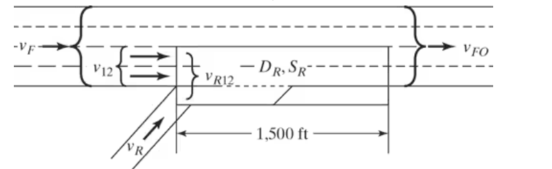
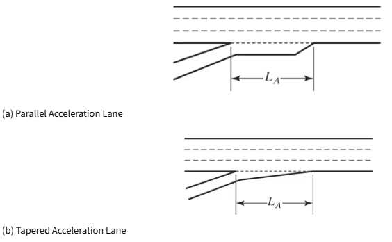

* $v_{12}= v_F \times P_{FM}$
  - Flow rate remaining in lanes 1 and 2 immediately upstream of the merge, $v_{12}$ 
  - $P_{FM}$ = proportion of approaching vehicle remaining in lanes 1 and 2 immediately upstream of the merge, decimal
  - $v_F$ = flow rate approaching the merge area, pc/h

##### 2A.1 **Determine $P_{FM}$ Equation**

* $v_D$ = flow rate on adjacent downstream ramp (pc/h)
* $v_U$ = flow rate on adjacent upstream ramp (pc/h)
* $L_{UP}$ = distance to upstream adjacent ramp (ft)
* $L_{DN}$ = distance to downstream adjacent ramp (ft)

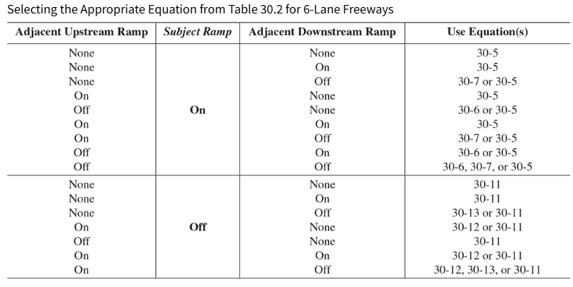

#### 2A.2 **The Equivalence Distance on Six-Lane Freeways**

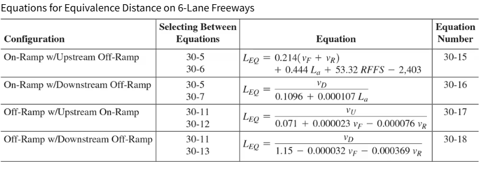

* If $L_{UP}$ or $L_{DN}$ $\ge L_{EQ}$ use the base equation for isolated ramps (30-5 for on-ramps, 30-11 for off-ramps).
* If $L_{UP}$ or $L_{DN}$ $< L_{EQ}$ use the configuration specific equation (30-6 or 30-7 for on-ramps, 30-12 or 30-13 for off-ramps).

#### 2A.3 **Checking the “Reasonableness” of $v_{12}$ Results**

* Reasonableness Criteria
  * <u>Criteria 1</u>: Average flow rate in the outer lanes may not exceed 2,700 pc/h/ln.
  * <u>Criteria 2</u>: Average flow rate in the outer lanes may not be more than 1.5 times the average flow rate in lanes 1 and 2.

| Freeway lanes | num of outer lanes  |
|---------------|:--------------------:|
| **4 (2/dir.)**|       0             |
| **6 (3/dir.)**|       1             |
| **8 (4/dir.)**|       2             |

* Adjust $v_{12}$ if either or both Criteria 1 & 2 are violated
* If <u>Criteria 1</u> is violated
  - set flow at outer lanes as 2,700 pc/h/ln
  - recalculate $v_{12} = v_F - 2700N_o$
    - $N_o$: number of outer lanes
* If <u>Criteria 2</u> is violated
  - set outer lane flow = $1.5 \times avg. v_{12}$
  - Recalculate $v_{12}$
    - For $N_o =1: v_{12} = \frac{V_F}{1.75}$
    - For $N_o =2: v_{12} = \frac{V_F}{2.50}$
    - For $N_o >2: v_{12} = \frac{2V_F}{1.50N_o+2}$
* If both <u>Criteria 1 & 2</u> is violated
  - revision that meets both criteria is used

### 2B. For diverge areas:

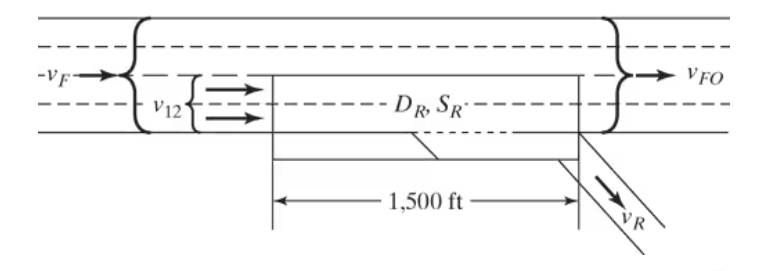
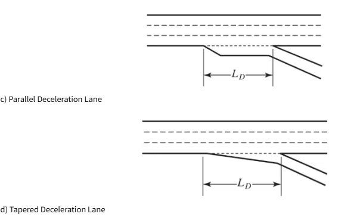

* $v_{12}= v_R + (v_F - v_R)\times P_{FD}$
  - Flow rate remaining in lanes 1 and 2 immediately upstream of the diverge, $v_{12}$ 
  - $P_{FM}$ = proportion of approaching vehicle remaining in lanes 1 and 2 immediately upstream of the diverge, decimal
  - $v_F$ = flow rate approaching the freeway vehicles, pc/h
  - $v_R$ = flow rate of off-ramp, pc/h

##### 2B.1 **Determine $P_{FD}$ Equation**

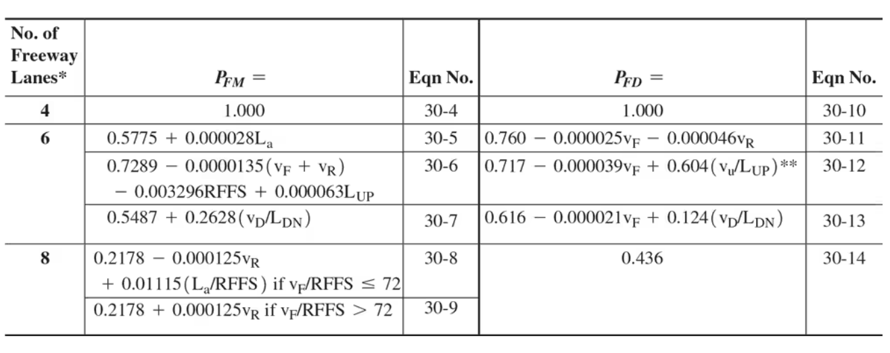
** when $v_u/L{UP} \le 0.20$ otherwise use Eq 30-11 

#### 2B.2 **The Equivalence Distance on Six-Lane Freeways**

* If $L_{UP}$ or $L_{DN}$ $\ge L_{EQ}$ use the base equation for isolated ramps (30-5 for on-ramps, 30-11 for off-ramps).
* If $L_{UP}$ or $L_{DN}$ $< L_{EQ}$ use the configuration specific equation (30-6 or 30-7 for on-ramps, 30-12 or 30-13 for off-ramps).

#### 2B.3 **Checking the “Reasonableness” of $v_{12}$ Results**

* Reasonableness Criteria
  * <u>Criteria 1</u>: Average flow rate in the outer lanes may not exceed 2,700 pc/h/ln.
  * <u>Criteria 2</u>: Average flow rate in the outer lanes may not be more than 1.5 times the average flow rate in lanes 1 and 2.

| Freeway lanes | num of outer lanes  |
|---------------|:--------------------:|
| **4 (2/dir.)**|       0             |
| **6 (3/dir.)**|       1             |
| **8 (4/dir.)**|       2             |

* Adjust $v_{12}$ if either or both Criteria 1 & 2 are violated
* If <u>Criteria 1</u> is violated
  - set flow at outer lanes as 2,700 pc/h/ln
  - recalculate $v_{12} = v_F - 2700N_o$
    - $N_o$: number of outer lanes
* If <u>Criteria 2</u> is violated
  - set outer lane flow = $1.5 \times avg. v_{12}$
  - Recalculate $v_{12}$
    - For $N_o =1: v_{12} = \frac{V_F}{1.75}$
    - For $N_o =2: v_{12} = \frac{V_F}{2.50}$
    - For $N_o >2: v_{12} = \frac{2V_F}{1.50N_o+2}$
* If both <u>Criteria 1 & 2</u> is violated
  - revision that meets both criteria is used

## STEP 3. Determine whether the demand flow exceeds the capacity {#step3}

#### 3A. Merge Area

**Merge section failure (LOS F) Check**:

* <u>Check 1: $v_{FO} < Cap_{DN}$</u>: Maximum freeway flow occurs downstream of the merge. Thus, the facility capacity is compared with the downstream facility flow $(v_{FO} = v_F + v_R)$
  - Where lanes are added, both the upstream $(v_F)$ and downstream  $(v_{FO})$ facility flows must be compared to capacity criteria.
* <u>Check 2: $v_{12R} < Cap_{maxDesireable}$</u>: Flow entering the ramp influence area is $v{12R}=v{12}+v{R}$. This sum is compared to the maximum desirable flow indicated in following table.

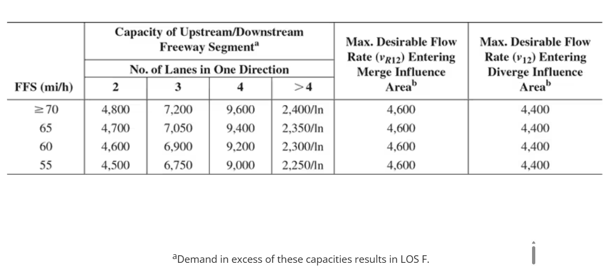

* <u>Check 3: $v_{R} < Cap_{R}$</u>: All ramp flows, $v_R$ must be checked against the ramp capacities given in below.

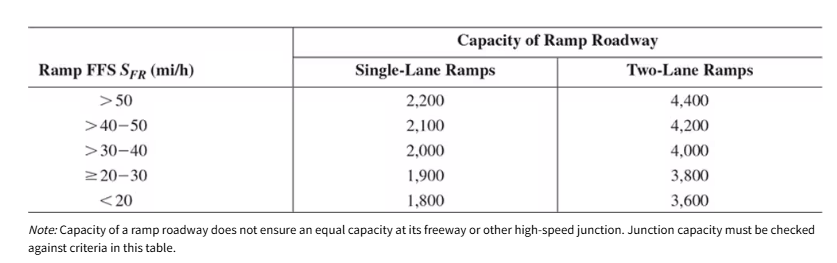

#### 3B. Diverge Area

## STEP 4. Determine the density $(D)$ & LOS of all vehicles within the ramp influence area {#step4}

* $D_R$ = density in the ramp influence area

#### 4A. Merge Area

$$D_R = 5.475 + 0.00734v_R+0.0078v_{12}-0.00627L_a$$

#### 4B. Diverge Area

$$D_R = 4.252 + 0.0086v_{12}-0.009L_d$$

#### 4C. LOS Table

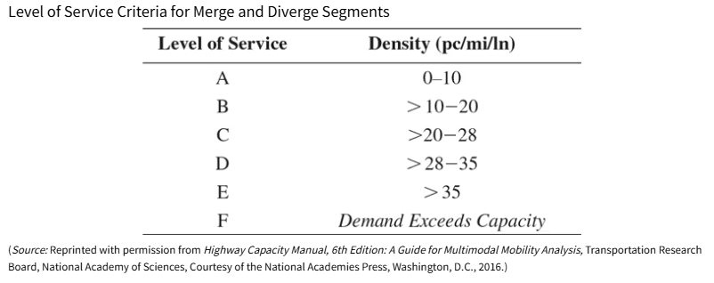

## STEP 5. Determine the speed of all vehicles within the ramp influence area and across all facility lanes {#step5}

#### 5A. Merge Area

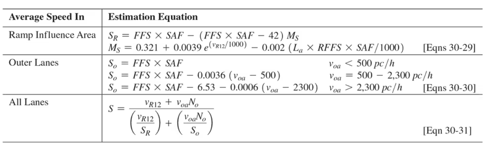

* $S_R$ = average speed of vehicles within the ramp influence, mph
* $S_o$ = average speed of vehicles in the outer lane (where they exist) for 1,500ft length of ramp influence area, mph
* $S$ = average speed of all vehicles for 1,500ft length of ramp influence area, mph
* $M_S$ = scaling factor for merge segments
* $v_{oa}$ = average flow rate in outer lanes (where they exists), pc/h/ln

#### 5B. Diverge Area

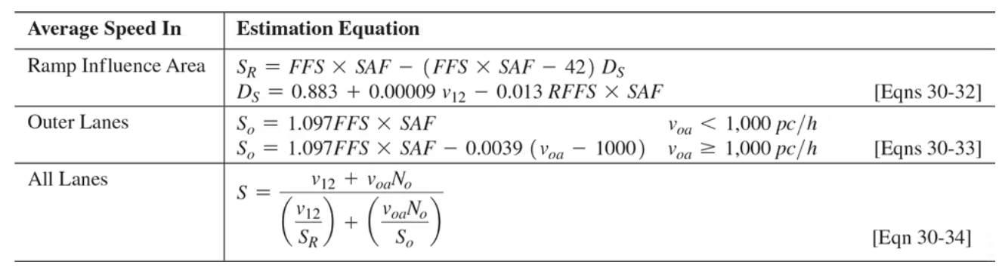

* $S_R$ = average speed of vehicles within the ramp influence, mph
* $S_o$ = average speed of vehicles in the outer lane (where they exist) for 1,500ft length of ramp influence area, mph
* $S$ = average speed of all vehicles for 1,500ft length of ramp influence area, mph
* $D_S$ = scaling factor for diverge segments
* $v_{oa}$ = average flow rate in outer lanes (where they exists), pc/h/ln
