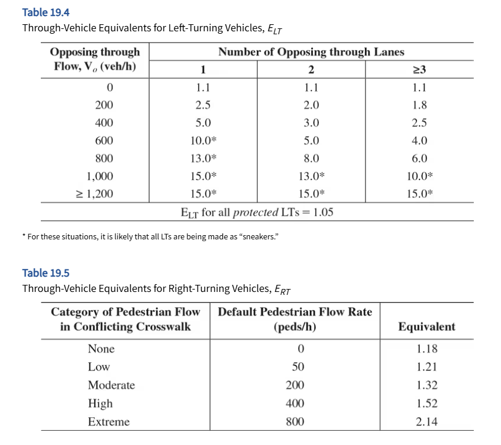

# PRE-TIMED vs. ACTUATED

* Pre-timed
  - Non-flexible to accomade demand change
    - Signal timing are constant from cycle to cycle
    - Uniform phase sequence, cycle length, and all interval times
* Actuated
  - flex to handle varying demand periods throughout the day, including peak and off-peak periods and changes in the balance of movements.
  -  signal timing on a cycle-by-cycle basis
    - information on current demands and operations, obtained from detectors

# TYPES OF ACTUATED CONTROL

* Semi-actuated
  - small-side street interacts with major arterial or collector
  - When Warrants 1B is met
  - Two-phase with all turn being "permitted"
  - Detectors on the side street
* Full-actuated 
  - all lanes of all approaches are monitored by detectors. 
  - phase sequence, green allocations, and cycle length are all subject to variation
  - effective for both two-phase and multiphase operations and can accommodate optional phases.

# DETECTOR in ACTUATED CONTROL

## Detection Types

* Passage or Point Detection
  - The passage of a vehicle over a short detector creates a pulse.
  - pulse indicates that at least one vehicle (in the approach and lane of the detector) requires service.
  - No memory of number of such pulses 
* Presence or Area Detection
  - The presence of a vehicle within a detection zone creates a continuous pulse. 
  - pulse begins when the vehicle enters the detection zone and terminates when the vehicle leaves it. 
  - detector(s) can discern the number of vehicles stored in the detection area.

## Detector to Controller Connection

* Two modes: 
  - Locked 
    - detector actuation creates a continuous call for service until the green is initiated for the subject lane(s)
    - Passage or point detectors are always linked in the locked mode.
  - Unlocked:
    - call for service is initiated when a vehicle enters the detection zone, and is terminated when it leaves the detection zone. 
    - Presence or area detectors are almost always linked in the unlocked mode, unless the front end of the detection zone is more than 2 to 3 ft from the STOP line.

## Detector Types

* Inductive Loop
* Microloop
* Magnetic

# SIGNAL DESIGN: ACTUATED CONTROL 
## Philosophy

## Terminologies

* Minimum Green Time: 
  - Each actuated phase has a minimum green time, which serves as the smallest amount of green time that may be allocated to a phase when it is initiated
* Passage Time (PT):
  - This time actually serves three different purposes: (1) It represents the maximum gap between actuations at a single detector required to retain the green. (2) It is the amount of time added to the green phase when an additional actuation is received within the unit extension. (3) It must be of sufficient length to allow a vehicle to travel from the detector to the STOP line.
* Maximum Green Time: 
  - Each phase has a maximum green time that limits the length of a green phase, even if there are continued actuations that would normally retain the green. The “maximum green time” begins when there is a “call” (or detector actuation) on a competing phase.
* Recall Settings. 
  - Each actuated phase has a number of recall settings. The recall settings determine what happens to the signal when there is no demand or a system failure.
* Yellow and All-Red Intervals. 
  - Yellow and all-red intervals provide for safe transition from “green” to “red.” They are fixed times and are not subject to variation, even in an actuated controller. They are found in the same manner as for pre-timed signals (refer to Chapter 19).
* Pedestrian WALK (“Walking Man”), Clearance (“Flashing Up-raised Hand”), and DON’T WALK (“Up-raised Hand”) intervals.
  - Pedestrian intervals must also be set. With actuated signals, however, the total length of the GREEN is not known. Thus, pedestrian intervals are set in accordance with the minimum green time for each phase. Pedestrian push buttons are often, but not always, needed to ensure adequate crossing times.

The “green” is terminated in one of two ways:

* A unit extension of PT seconds expires without an additional actuation. Such a termination is commonly referred as a “gap out.”
* The maximum green is reached. Such a termination is referred to as a “max out.” The maximum green begins timing out when a “call” on a competing phase is noted. During the most congested periods of flow, however, it may be assumed that demand exists more or less continuously on all phases. The maximum green, therefore, begins timing out at the beginning of the green period in such a situation.

# STEPS

* [STEP 1. Check for LT treatment and Develop a Phase Plan](#step1)    
* [STEP 2. Convert Volumes to Through Vehicle Equivalents](#step2)    
* [STEP 3. Determine Lane Groups and Critical Lane Volumes](#step3)   
* [STEP 4. Determine Yellow and All-Red Intervals](#step4) 
* [STEP 5. Determine the Lost time](#step5)
* [STEP 6. Determine the Desireable Cycle Length](#step6)
* [STEP 7. Allocate Effective Green to Each Phase](#step7)
* [STEP 8. Check Pedestrian Requirements](#step8)

## Terminologies

## STEP 1. Check for LT treatment and Develop a Phase Plan {#step1}
### 1A - Left-turn Signal: Protected or  Permitted?
If <u>either of the two criteria</u> below are exceeded, it is common practice to implement some form of left-turn protection:

* Criteria 1: $\nu_{LT} \ge 200$ veh/h
* Criteria 2 (Cross-product rule): $xprod =  \nu_{LT} \times \frac{\nu_0}{N_0} \ge 50,000$

where,

* $\nu_{LT}$ = left-turn flow rate, veh/h
* $\nu_0$ = opposing through movement flow rate, veh/h
* $N_0$ = number of opposing through lanes

### 1B - Develop Phasing Diagram

#### Phase Diagram
A phase diagram shows all movements being made in a given phase within a single block of the diagram. 

#### Ring Diagram
A ring diagram shows which movements are controlled by which “ring” on a signal controller. A “ring” of a controller generally controls one set of signal faces.

#### Definition of Phasing Symbols

1. A solid arrow denotes a movement without opposition. All through movements are unopposed by definition. An unopposed left turn has no opposing through vehicular flow. An unopposed right turn has no opposing pedestrian movement in the crosswalk through which the right turn is made.
2. Opposed left- and or right-turn movements are shown as a dashed line.
3. Turning movements made from a shared lane(s) are shown as arrows connected to the through movement that shares the lane(s).
4. Turning movements from an exclusive lane(s) are shown as separate arrows, not connected to any through movement.

## STEP 2. Convert Volumes to Through Vehicle Equivalents {#step2}

* Equivalent LT volume in through-vehicle equivalents, $V_{LTE} = V_{LT} \times E_{LT}$ tvu/h
* Equivalent RT volume in through-vehicle equivalents, $V_{RTE} = V_{RT} \times E_{RT}$ tvu/h
* Total equivalent volume for a given approach or lane group, $V_{EQ} = V_{LTE} + V_{TH} + V_{RTE}$ tvu/h
  - Per lane: $V_{EQL} = V_{EQ} / N$ tvu/h
  

<u>NOTE:</u> Interpolation allowed

## STEP 3. Determine Lane Groups and Critical Lane Volumes {#step3}

critical-lane volume is the per-lane volume that controls the required length of a particular phase.
To find the critical path, the controlling (maximum) equivalent volumes must be found for each portion of the cycle, working between full-phase transition boundaries. 
## STEP 4. Determine Yellow and All-Red Intervals {#step4}

### Yellow Interval
The ITE recommends the following methodology for determining the length of the yellow or change interval 

$$y_i = t + \frac{1.47 \times S_{85i}}{2 \times (a + 32.2 G_i)}$$
where:

* $y_i$ = length of the yellow for phase $i$, sec
* $t$ = driver reaction time, sec (Default is <mark>1 sec</mark>)
* $S_{85i}$ = 85th percentile speed of approaching vehicle in phase $i$ or Speed Limit (mph)
  - $S_{85i} = S_{avg} + 5$
* $a$ = Deceleration rate of vehicles, $ft/s^2$
* $G_i$ = Approach grade for phase $i$ in decimal

### All-red Interval
The ITE also recommends the following policy for determining the length of all-red clearance intervals 

| Pedestrian Traffic  | All-Red Interval Eqn            |
|---------------------|---------------------------------|
| **No or Little Ped**|$ar_i = \frac{w+L}{1.47S_{15i}}$ |
| **Somewhat Ped**    |                                |
| **Significant Ped  **|$ar_i = \frac{P+L}{1.47S_{15i}}$ |

Where:

* $ar_i$ = length of the all-red phase for phase $i$, sec
* $w$ = width of the street being crossed, from curb to curb, ft
* $P$ = distance from the near curb to the far side of the crosswalk on the departure leg, ft
* $L$ = length of the standard vehicle (18-20 feet)
* $S_{15i}$ = 15th percentile speed of approaching traffic in phase $i$, mph
  - $S_{15i} = S_{avg} - 5$

<u>NOTE:</u>
Use of these ITE policies to determine yellow and all-red intervals assures that drivers will not be presented with a “dilemma zone,” which occurs when the combined length of the change and clearance intervals is not sufficient to allow a motorist who cannot safely stop when the yellow is initiated to cross through the intersection and out of conflicting vehicular and/or pedestrian paths before those flows are released.
  
## STEP 5. Determine the Lost time {#step5}

HCM recommends the following:

* Start-up lost time, $l_{1i} = 2$ sec/phase
* Motorist use of yellow and all-red, $e= 2$ sec/phase
* Clearance lost time, $l_{2i} = y_i + ar_i - e$ sec/phase
* Total lost time, $t_{Li} = l_{1i} + l_{2i} = 2 + y_i + ar_i - e$ sec/phase

## STEP 6. Determine the Desireable Cycle Length {#step6}

$$C_{des} = \frac{L}{1 - \frac{V_c}{1700 \times PHF \times (\nu/c)}}$$
Where:

* $C_{des}$ = Desireable cycle lenght, sec
* $L$ = Total lost time per cycle, sec
* $PHF$ = peak hour factor
* $\nu/c$ = targe volume-to-capacity ration for the critical movements in the intersections

## STEP 7. Allocate Effective Green to Each Phase {#step7}

* Total Effective green time in the cycle,  $g_{TOT} = C - L$
* $g_i = g_{TOT} \times (\frac{V_{ci}}{V_c})$

Where:
* $g_i$ = effective green time for phase $i$, sec
* $V_{ci}$ = critical lane volume for phase $i$, tvu/h
* $V_c$ = sum of all the critical lane volumes, tvu/h

## STEP 8. Check Pedestrian Requirements {#step8}

