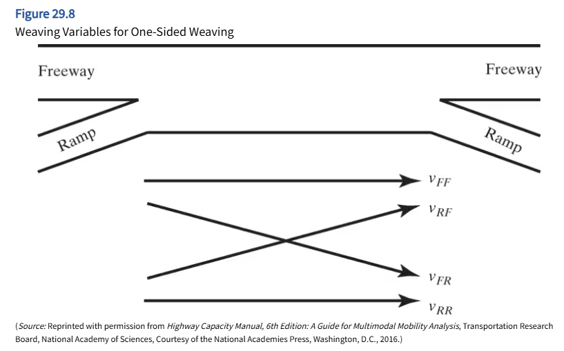
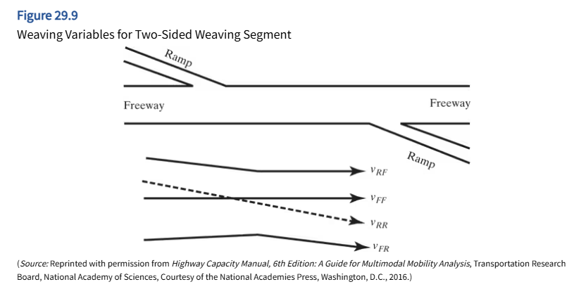
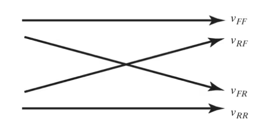
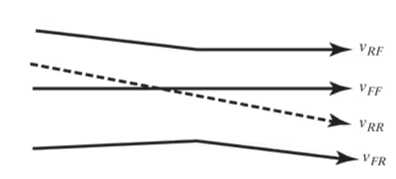
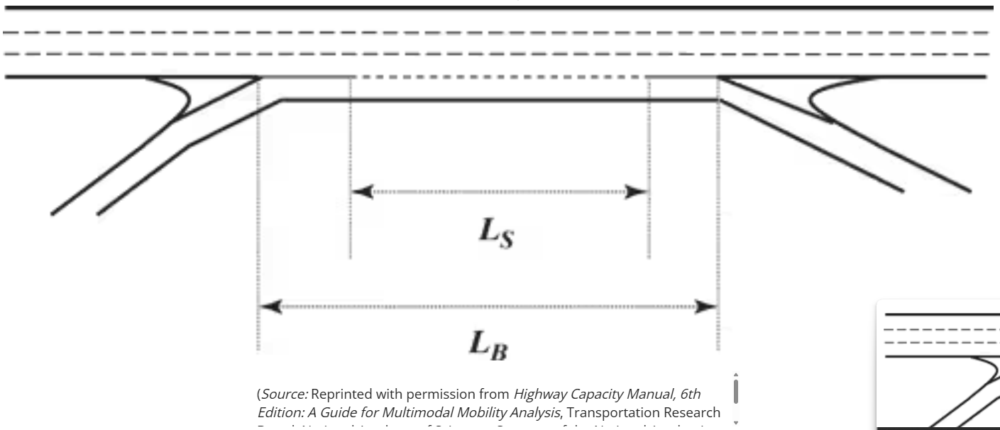
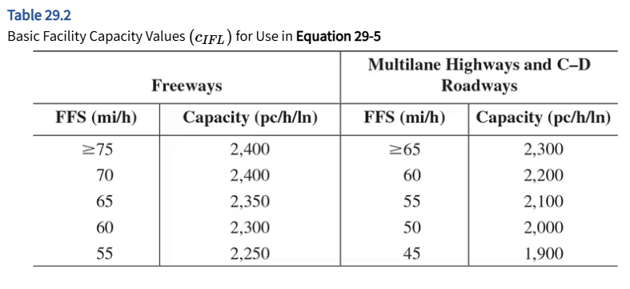
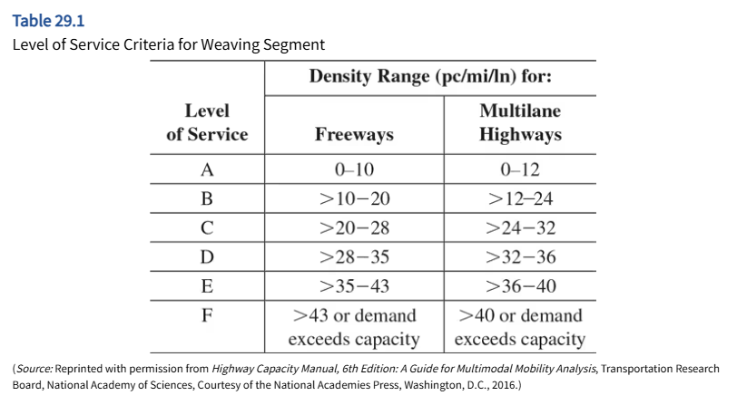

# STEPS

* [STEP 1. Convert all demand volumes $(V)$ to Flow rates $(v)$](#step1)    
* [STEP 2. Determine critical flows or variables for weaving analysis](#step2)    
* [STEP 3. Determine configuration characteristics](#step3)   
* [STEP 4. Determine max weaving length](#step4) 
* [STEP 5. Determine capacity of weaving segment](#step5)
* [STEP 6. Determine lane changing rates](#step6)
* [STEP 7. Determine the average speed of weaving and non-weaving vehicles](#step7)
* [STEP 8. Determine density and LOS](#step8)

## STEP 1. Convert all demand volumes ($V$) to Flow rates ($\nu$) {#step1}

:::: {.columns}

::: {.column width="45%"}

:::

::: {.column width="55%"}

:::

::::

$$v_i = \frac{V}{PHF \times f_{HV} \times f_p}$$

* $v_i$ = flow rate per lane under equivalent ideal condition (pc/hr/ln)
  - $i \in \{FF, RF, FR, RR\}$
  - $V$ = demand volume (veh/hr)
  - $PHF$ = peak-hour factor
  - $f_{HV}$ = adj. factor for presence of heavy vehicles (HV)
    - $f_{HV} = \frac{1}{1+P_{HV}(E_{HV}-1)}$
  - $f_p$ = familiarity of drivers' population of the roadway
* $v_{FF}$ = demand flow rate of <u>freeway-to-freeway</u> in the weaving section, pc/h 
* $v_{RF}$ = demand flow rate of <u>ramp-to-freeway</u> in the weaving section, pc/h 
* $v_{FR}$ = demand flow rate of <u>freeway-to-ramp</u> in the weaving section, pc/h 
* $v_{RR}$ = demand flow rate of <u>ramp-to-ramp</u> in the weaving section, pc/h 

## STEP 2. Determine critical flows or variables for weaving analysis {#step2}

:::: {.columns}

::: {.column width="50%"}

:::

::: {.column width="50%"}

:::

::::

* $v_W$ = demand flow rate of <u>weaving</u> in the weaving section, pc/h
* $v_{NW}$ = demand flow rate of <u>non-weaving</u> in the weaving section, pc/h

|                 | One-sided weave             | Two-sided weave                       |
|-----------------|:----------------------------|:-------------------------------------:|
| **Weaving**     | $v_W =  v_{RF} + v_{FR}$    | $v_W =  v_{RR}$  |
| **Non-Weaving** | $v_{NW} = v_{FF} + v_{RR}$  | $v_{NW} = v_{FR} +v_{RF}+ v_{FF}$  |

* $v$ = total demand flow rate total in the weaving section, pc/h
  - $v = v_w + v_{nw}$
* $\frac{v}{N}$ = demand flow rate per lane in the weaving section, pc/h/ln
* $VR$ = volume ratio
  - $VR = \frac{v_w}{v}$

## STEP 3. Determine configuration characteristics {#step3}

* $N_{WV}$ = number of lanes from which a weaving movement can be successfully executed with no more than one lane change
* $LC_{MIN}$ = minimum number of lane changes that must be made by all weaving vehicles to complete their maneuvers successfully

| One-sided weave                                               | Two-sided weave                       |
|:--------------------------------------------------------------|:-------------------------------------:|
| $$LC_{MIN} = (LC_{FR} \times v_{FR})+(LC_{RF} \times v_{RF})$$| $$LC_{MIN} = LC_{RR} \times v_{RF}$$  |

* $LC_{RF}$ = minimum number of lane changes that must be made by single weaving vehicles from the on-ramp to the facility
* $LC_{FR}$ = minimum number of lane changes that must be made by single weaving vehicles from the facility to the on-ramp
* $LC_{RR}$ = minimum number of lane changes that must be made by single weaving vehicles from the on-ramp to the off-ramp
* $v_{RF}$ = demand flow rate (pc/h) for ramp to facility = $v_{w2}$
* $v_{FR}$ = demand flow rate (pc/h) for facility to ramp  = $v_{w1}$

## STEP 4. Determine max weaving length {#step4}

Is the freeway segment weaving section or not?

* $L_{MAX} = [5728(1+VR)^{1.6}]-[1566N_{WV}]$
* Compare $L_{MAX}$ with $L_{S}$

  - $L_S$ = Short length (ft); distance between the end points of any barrier markings that prohibit or discourage lane change
  - If $L_{MAX} \ge L_S$:  **Weaving Section**
  - If $L_{MAX} < L_S$:  Use merge and diverge analysis method
  
## STEP 5. Determine capacity of weaving segment {#step5}
### Concept
* Check if the flow is stable? $LOS \ne F$
* $LOS\ F: v_{demand} \ge v_{capacity} \to BREAKDOWN$
* BREAKDOWN Situation at Freeways
  - 1. For $LOS\ F$ when the density, $D = 43$pc/h/ln
  - 2. total weaving flow rate $(v_w)$ exceeds capacity of the segment to handle weaving flows
  
|              | Max weaving flow rate   (Total both weaving flows) |
|--------------|:-------------------------------------------------:|
| $N_{WV} = 2$ | $2,400$ pc/h                                     |
| $N_{WV} = 3$ | $3,500$ pc/h                                     |

### Equation
  
Effective demand-to-capacity ratio:

$$v/c = \frac{v \times f_{HV} \times f_p}{c_W}$$

* $v$ = total demand flow rate total in the weaving section, pc/h
  - $v = v_w + v_{nw}$
* $c_W$ = Capacity of the weaving segment, (veh/h)
  - $c_W = min(c_{W1}, c_{W2})$
  - $c_{W1}$ = capacity (veh/h) of the weaving section based on breakdown density
  - $c_{W2}$ = capacity (veh/h) of the weaving section based on max weaving flow rates

<mark>$v/c > 1.00$</mark> **LOS F** is assigned to the section

### Step 5.1 Based on Breakdown Density, $c_{W1}$

* $c_{W1} = c_{IWL} \times N \times f_{HV} \times f_p$
  - $c_{W1}$ = capacity (veh/h) of the weaving section based on breakdown density
  - $c_{IWL} = c_{IFL} - [438.2(1+VR)^{1.6}] + [0.0765L_S] + [119.8N_{WV}]$
    - $c_{IWL}$ = capacity (pc/h/lane) of weaving section under ideal conditions
    - $c_{IFL}$ = capacity (pc/h/lane) basic facility segment with same FFS

### Step 5.2 Based on Maximum Weaving Flow Rates $c_{W2}$

* number of weaving vehicles reaches capacity before density of the weaving segment reaches 43 pc/h/ln
* $c_{W2} = c_{IW} \times f_{HV} \times f_p$
  - $c_{W2}$ = capacity (veh/h) of the weaving section based on max weaving flow rate
  - $c_{IW}$ = capacity (pc/h/lane) of weaving section under ideal conditions

|              | $c_{IW}$             |
|--------------|:--------------------:|
| $N_{WV} = 2$ | $\frac{2,400}{VR}$   |
| $N_{WV} = 3$ | $\frac{3,500}{VR}$   |

## STEP 6. Determine lane changing rates {#step6}

* $LC_{ALL} = LC_W + LC_{NW}$
  - $LC_{ALL}$ = Total Lane-Changing Rate (LC)
  - $LC_W$ = Total Lane-Changing weaving vehicles
  - $LC_{NW}$ = Total Lane-Changing non-weaving vehicles

| Vehicles                  | Total Lane-Changing Rate (lc/h)                                             | 
|---------------------------|:---------------------------------------------------------------------------:|
| **Weaving**               | $LC_W = LC_{MIN}+0.39[(L_S-300)^{0.5}N^2(1+ID)^{0.8}]$                      | 
| **Non-Weaving: 1st est.** | $LC_{NW1} = (0.206 \times v_{NW}) + (0.542 \times L_S) - (192.6 \times N)$  |
| **Non-Weaving: 2nd est.** | $LC_{NW2} = 2135 + 0.223(v_{NW}-2000)$                                      |

* $LC_{NW1}$ = first estimate, nonweaving vehicle lane changing rate, lc/h
* $LC_{NW2}$ = second estimate, nonweaving vehicle lane changing rate, lc/h
* $N$ = number of lanes in the weaving segment
* $ID$ = interchange density, (interchange/mi)

* To determine which equation to use lane changing index, $I_{NW}$
  - $I_{NW}= \frac{L_S \times ID \times v_{NW}}{10,000}$

| $I_{NW}$ values                 | $LC_{NW}$ Equation to use                                        |
|---------------------------------|------------------------------------------------------------------|
| $I_{NW} \le 1,300$              | $LC_{NW} = LC_{NW1}$                                             |
| $1,300I_{NW} < I_{NW} < 1,950$  | $LC_{NW}=LC_{NW1}+(LC_{NW2}-LC_{NW1})(\frac{I_{NW}-1300}{650})$  |
| $I_{NW} \ge 1,950$              | $LC_{NW} = LC_{NW2}$                                             |

## STEP 7. Determine the average speed of weaving and non-weaving vehicles {#step7}

* **Average Speed of all Vehicles**, $S$
$$S = \frac{v_{W} + v_{NW}}{\frac{v_{W}}{S_{W}} + \frac{v_{NW}}{S_{NW}}}$$
  - $v_W$ = demand flow rate of <u>weaving</u> in the weaving section, pc/h
  - $v_{NW}$ = demand flow rate of <u>non-weaving</u> in the weaving section, pc/h
  - $S_W$ = average speed  of <u>weaving</u> in the weaving section, mph
  - $S_{NW}$ = average speed of <u>non-weaving</u> in the weaving section, mph

 
  
* **Average Speed of Weaving Vehicles**, $S_W$
$$S_W = S_{MIN} + (\frac{S_{MAX}- S_{MIN}}{1+W})$$
$$S_W = 15 + (\frac{FFS - 15}{1+W})$$
  - $S_{MIN} = 15 mph$ = min. average speed of <u>weaving</u> vehicles expected in the weaving section, mph
  - $S_{MAX} = FFS$ = max. average speed of <u>weaving</u> vehicles expected in the weaving section, mph
  - $W$ = weaving intesity factor
    - $W = 0.226(\frac{LC_{ALL}}{L_S})^{0.789}$

 

* **Average Speed of Non-Weaving Vehicles**, $S_{NW}$
$$S_{NW} = FFS \times SAF - (0.0072LC_{MIN}) - (0.0048\frac{v}{N})$$
  - $LC_{MIN}$ = minimum number of lane changes that must be made by all weaving vehicles to complete their maneuvers successfully
  - $v$ = total demand flow rate total in the weaving section, pc/h
    - $v = v_w + v_{nw}$
    - $N$ = number of lanes in the weaving segment

## STEP 8. Determine density and LOS {#step8}

$$D = \frac{(v/N)}{S}$$

* $D$ = density of the weaving section, pc/mi/ln
* $\frac{v}{N}$ = demand flow rate per lane in the weaving section, pc/h/ln
* $S$ = Average Speed of all Vehicles, mph

